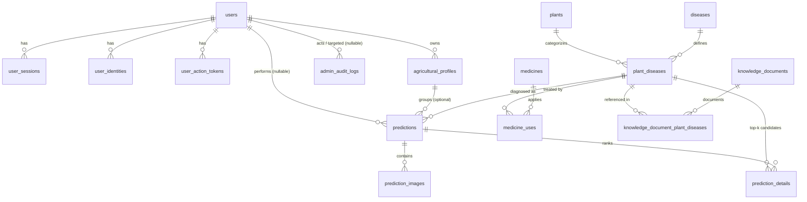

# Chi tiết Cơ sở Dữ liệu PostgreSQL (agrivision_db)

> **Thời điểm kiểm tra thực tế:** 17/10/2026
> **Môi trường:** Docker container `postgres:16-alpine` (dịch vụ `postgres`)
> **Nhánh Git:** `AGRI-127-database-improvement`
> **ORM Framework:** Entity Framework Core 9.0.2 (.NET 9)

---

## 1. Thông tin chung Cơ sở Dữ liệu

| Thuộc tính | Giá trị thực tế |
|---|---|
| **Database Name** | `agrivision_db` |
| **DBMS** | PostgreSQL 16.15 (Alpine Linux x86_64) |
| **Encoding** | `UTF8` |
| **Collation / Ctype** | `en_US.utf8` / `en_US.utf8` |
| **Database Owner** | `agrivision_user` |
| **Dung lượng hiện tại** | ~8.4 MB (chứa schema và catalog hạt giống) |
| **Tổng số bảng** | **17 bảng** (16 bảng nghiệp vụ + 1 bảng kỹ thuật `__EFMigrationsHistory`) |
| **Tổng số Index** | **46 indexes** (bao gồm Primary Keys, Unique Constraints và Search B-Trees) |

---

## 2. Lịch sử Migration đã áp dụng (`__EFMigrationsHistory`)

Toàn bộ schema hiện tại được đồng bộ tự động qua 5 migration chính thức của EF Core:

| STT | Migration ID | Phiên bản EF | Nội dung thay đổi chính |
|---|---|---|---|
| 1 | `20260925161222_InitialCreate` | 9.0.2 | Tạo baseline sơ khai gồm các bảng người dùng, cây trồng, bệnh và chẩn đoán. |
| 2 | `20261006161042_ConfirmedRequirementsSchema` | 9.0.2 | Hoàn thiện 9 bảng nghiệp vụ: thêm quản lý ảnh đa góc độ (`prediction_images`), top-K xác suất (`prediction_details`), định danh OAuth (`user_identities`), token xác thực (`user_action_tokens`), và snapshot JSONB cho kết quả chẩn đoán. |
| 3 | `20261007032722_DatasetV14Catalog` | 9.0.2 | Nạp dữ liệu hạt giống chuẩn v1.4: 10 cây trồng, 44 tình trạng bệnh, 59 lớp nhận diện (indices 0–58). |
| 4 | `20261017084014_DatabaseImprovement` | 9.0.2 | Mở rộng theo phạm vi AGRI-127 (US-01 đến US-10): thêm hồ sơ nông trại (`agricultural_profiles`), phiên đăng nhập (`user_sessions`), nhật ký quản trị (`admin_audit_logs`), danh mục thuốc BVTV (`medicines`, `medicine_uses`), tài liệu tri thức (`knowledge_documents`, `knowledge_document_plant_diseases`), và cờ `users.is_active`. |
| 5 | `20261017084202_OptionalAgriculturalProfiles` | 9.0.2 | Điều chỉnh `predictions.agricultural_profile_id` thành `nullable` để hỗ trợ chẩn đoán linh hoạt không bắt buộc chọn hồ sơ nông nghiệp. |

---

## 3. Tổng hợp Bảng và Số lượng Bản ghi Thực tế

| Tên bảng | Nhóm chức năng | Số dòng hiện tại | Trạng thái dữ liệu |
|---|---|:---:|---|
| `__EFMigrationsHistory` | Hệ thống / EF Core | 5 | Lưu 5 mốc migration đã chạy. |
| `plants` | Danh mục nông nghiệp | **10** | Dữ liệu gốc 10 loại cây trồng (Cà chua, Cà phê, Cam, Chè, Lúa, Ngô, Nho, Ớt, Sầu riêng, Xoài). |
| `diseases` | Danh mục nông nghiệp | **44** | Dữ liệu gốc 44 bệnh lý / tình trạng (bao gồm cả trạng thái Khỏe mạnh). |
| `plant_diseases` | Danh mục nông nghiệp / AI | **59** | 59 cặp Cây - Bệnh (class index 0 đến 58) khớp hoàn toàn với model ConvNeXt-Tiny v1.4. |
| `users` | Người dùng & Xác thực | 0 | Chưa có tài khoản production (được tạo qua API/seed dev). |
| `user_sessions` | Người dùng & Xác thực | 0 | Phiên làm việc/đăng nhập của người dùng. |
| `user_identities` | Người dùng & Xác thực | 0 | Liên kết đăng nhập bên thứ 3 (Google, Apple...). |
| `user_action_tokens` | Người dùng & Xác thực | 0 | Token xác thực email và đặt lại mật khẩu. |
| `agricultural_profiles` | Hồ sơ nông trại | 0 | Hồ sơ canh tác của người dùng. |
| `predictions` | Chẩn đoán AI | 0 | Lịch sử kết quả chẩn đoán chính. |
| `prediction_details` | Chẩn đoán AI | 0 | Chi tiết top-K xác suất cho từng lượt chẩn đoán. |
| `prediction_images` | Chẩn đoán AI | 0 | Quản lý ảnh đính kèm (nhiều ảnh, hạn lưu trữ 30 ngày). |
| `medicines` | Tri thức & Thuốc BVTV | 0 | Danh mục thuốc bảo vệ thực vật chính thức. |
| `medicine_uses` | Tri thức & Thuốc BVTV | 0 | Hướng dẫn sử dụng thuốc gắn với từng bệnh cây trồng cụ thể. |
| `knowledge_documents` | Tri thức & Thuốc BVTV | 0 | Thư viện bài viết, cẩm nang canh tác và phòng trừ bệnh. |
| `knowledge_document_plant_diseases` | Tri thức & Thuốc BVTV | 0 | Liên kết bài viết tri thức với từng bệnh cây trồng. |
| `admin_audit_logs` | Quản trị hệ thống | 0 | Ghi log hành động nhạy cảm của Admin. |

---

## 4. Chi tiết Cấu trúc Từng Bảng và Ràng buộc

### 4.1. Nhóm Danh mục Cây trồng & Bệnh học

#### 1. Bảng `plants` (Cây trồng)
*Quản lý danh sách loài cây được hỗ trợ nhận diện.*
- **Các cột:**
  - `id` (`uuid`, PK, NOT NULL)
  - `name` (`varchar(100)`, NOT NULL): Tên định danh chuẩn tiếng Anh/không dấu (vd: `Ca_chua`, `Lua`).
  - `vietnamese_name` (`varchar(150)`, NULL): Tên hiển thị tiếng Việt (vd: `Cà chua`, `Lúa`).
  - `scientific_name` (`varchar(200)`, NULL): Tên khoa học của cây.
  - `description` (`text`, NULL): Mô tả đặc tính cây trồng.
  - `is_active` (`boolean`, NOT NULL, default `true`): Trạng thái hoạt động.
  - `created_at` (`timestamptz`, NOT NULL)
  - `updated_at` (`timestamptz`, NULL)
- **Chỉ mục & Ràng buộc:**
  - `PK_plants` (UNIQUE btree trên `id`)
  - `ix_plants_name` (UNIQUE btree trên `name`)

#### 2. Bảng `diseases` (Bệnh & Tình trạng)
*Quản lý danh mục bệnh lý, triệu chứng và giải pháp điều trị.*
- **Các cột:**
  - `id` (`uuid`, PK, NOT NULL)
  - `name` (`varchar(150)`, NOT NULL): Mã định danh tình trạng (vd: `Dom_la`, `Khoe_manh`).
  - `vietnamese_name` (`varchar(200)`, NULL): Tên bệnh tiếng Việt (vd: `Đốm lá`, `Khỏe mạnh`).
  - `condition_type` (`varchar(30)`, NOT NULL, default `'Unknown'`): Loại tình trạng.
  - `symptoms` (`text`, NULL): Triệu chứng nhận biết trên lá/thân.
  - `treatment` (`text`, NULL): Hướng dẫn điều trị.
  - `prevention` (`text`, NULL): Biện pháp phòng ngừa.
  - `medication` (`text`, NULL): Gợi ý thuốc điều trị.
  - `is_content_approved` (`boolean`, NOT NULL, default `false`): Cờ kiểm duyệt nội dung y khoa/nông nghiệp.
  - `is_active` (`boolean`, NOT NULL, default `true`)
  - `created_at` (`timestamptz`, NOT NULL), `updated_at` (`timestamptz`, NULL)
- **Chỉ mục & Ràng buộc:**
  - `PK_diseases` (UNIQUE btree trên `id`)
  - `ix_diseases_name` (UNIQUE btree trên `name`)
  - Check `ck_diseases_condition_type`: `condition_type IN ('Unknown', 'Healthy', 'NutrientDeficiency', 'Disease')`

#### 3. Bảng `plant_diseases` (Cây - Bệnh & Class Mapping Model)
*Ánh xạ giữa loài cây và bệnh cụ thể, đồng thời là cầu nối trực tiếp tới 59 lớp phân loại của mô hình AI.*
- **Các cột:**
  - `id` (`uuid`, PK, NOT NULL)
  - `plant_id` (`uuid`, FK -> `plants.id`, RESTRICT, NOT NULL)
  - `disease_id` (`uuid`, FK -> `diseases.id`, RESTRICT, NOT NULL)
  - `class_name` (`varchar(255)`, NOT NULL): Tên nhãn lớp mô hình (vd: `Ca_chua___Dom_la`).
  - `class_index` (`int`, NOT NULL): Số thứ tự lớp từ 0 đến 58.
  - `is_active` (`boolean`, NOT NULL, default `true`)
- **Chỉ mục & Ràng buộc:**
  - `PK_plant_diseases` (UNIQUE btree trên `id`)
  - `ix_plant_diseases_class_index` (UNIQUE btree trên `class_index`)
  - `ix_plant_diseases_plant_id_disease_id` (UNIQUE btree trên `(plant_id, disease_id)`)
  - `ix_plant_diseases_plant_id`, `ix_plant_diseases_disease_id` (btree tra cứu FK)
  - Check `ck_plant_diseases_class_index`: `class_index >= 0`

---

### 4.2. Nhóm Người dùng & Bảo mật

#### 4. Bảng `users` (Tài khoản)
*Lưu thông tin người dùng, quyền hạn và trạng thái kích hoạt.*
- **Các cột:**
  - `id` (`uuid`, PK, NOT NULL)
  - `full_name` (`varchar(150)`, NOT NULL)
  - `email` (`varchar(255)`, NOT NULL)
  - `password_hash` (`text`, NULL): Nullable đối với người dùng đăng nhập hoàn toàn bằng OAuth (Google).
  - `role` (`varchar(30)`, NOT NULL, default `'User'`): Vai trò (`User`, `Admin`).
  - `email_verified_at` (`timestamptz`, NULL): Thời điểm hoàn tất xác minh email.
  - `is_active` (`boolean`, NOT NULL, default `true`): Cho phép vô hiệu hóa/khóa tài khoản.
  - `created_at` (`timestamptz`, NOT NULL), `updated_at` (`timestamptz`, NULL)
- **Chỉ mục & Ràng buộc:**
  - `PK_users` (UNIQUE btree trên `id`)
  - `ix_users_email` (UNIQUE btree trên `email`)

#### 5. Bảng `user_sessions` (Phiên làm việc)
*Theo dõi phiên đăng nhập để hỗ trợ cơ chế đăng xuất an toàn và thu hồi phiên.*
- **Các cột:**
  - `id` (`uuid`, PK, NOT NULL)
  - `user_id` (`uuid`, FK -> `users.id`, CASCADE, NOT NULL)
  - `created_at` (`timestamptz`, NOT NULL)
  - `expires_at` (`timestamptz`, NOT NULL)
  - `revoked_at` (`timestamptz`, NULL): Thời điểm phiên bị thu hồi/đăng xuất.
- **Chỉ mục & Ràng buộc:**
  - `PK_user_sessions` (UNIQUE btree trên `id`)
  - `IX_user_sessions_user_id_expires_at` (Partial Index trên `(user_id, expires_at)` với điều kiện `WHERE (revoked_at IS NULL)`)
  - Check `ck_user_sessions_expiry`: `expires_at > created_at`
  - Check `ck_user_sessions_revocation`: `revoked_at IS NULL OR revoked_at >= created_at`

#### 6. Bảng `user_identities` (Định danh OAuth)
*Hỗ trợ người dùng đăng nhập bằng tài khoản bên ngoài (Google).*
- **Các cột:**
  - `id` (`uuid`, PK, NOT NULL)
  - `user_id` (`uuid`, FK -> `users.id`, CASCADE, NOT NULL)
  - `provider` (`varchar(30)`, NOT NULL): Tên nhà cung cấp (vd: `'Google'`).
  - `provider_subject` (`varchar(255)`, NOT NULL): ID người dùng trả về từ provider.
  - `created_at` (`timestamptz`, NOT NULL)
- **Chỉ mục:**
  - `PK_user_identities` (UNIQUE btree trên `id`)
  - `IX_user_identities_provider_provider_subject` (UNIQUE btree trên `(provider, provider_subject)`)
  - `IX_user_identities_user_id` (btree tra cứu theo user)

#### 7. Bảng `user_action_tokens` (Mã bảo mật thao tác)
*Token sử dụng một lần cho kích hoạt email hoặc đổi mật khẩu quên.*
- **Các cột:**
  - `id` (`uuid`, PK, NOT NULL)
  - `user_id` (`uuid`, FK -> `users.id`, CASCADE, NOT NULL)
  - `purpose` (`varchar(30)`, NOT NULL): Mục đích token.
  - `token_hash` (`varchar(64)`, NOT NULL): Hash SHA-256 của token.
  - `created_at` (`timestamptz`, NOT NULL)
  - `expires_at` (`timestamptz`, NOT NULL)
  - `consumed_at` (`timestamptz`, NULL): Thời điểm token đã được sử dụng.
- **Chỉ mục & Ràng buộc:**
  - `PK_user_action_tokens` (UNIQUE btree trên `id`)
  - `IX_user_action_tokens_token_hash` (UNIQUE btree trên `token_hash`)
  - `IX_user_action_tokens_user_id`, `IX_user_action_tokens_expires_at`
  - Check `ck_user_action_tokens_hash`: `token_hash ~ '^[0-9a-f]{64}$'` (bắt buộc đúng 64 ký tự hex)
  - Check `ck_user_action_tokens_purpose`: `purpose IN ('EmailVerification', 'PasswordReset')`
  - Check `ck_user_action_tokens_expiry`: `expires_at > created_at`

---

### 4.3. Nhóm Hồ sơ Nông nghiệp & Chẩn đoán Bệnh

#### 8. Bảng `agricultural_profiles` (Hồ sơ Nông trại)
*Nhóm các lần chẩn đoán theo từng vườn/thửa ruộng/khu vực canh tác của nông dân.*
- **Các cột:**
  - `id` (`uuid`, PK, NOT NULL)
  - `user_id` (`uuid`, FK -> `users.id`, CASCADE, NOT NULL)
  - `name` (`varchar(150)`, NOT NULL): Tên vườn/hồ sơ (không được rỗng).
  - `description` (`text`, NULL): Ghi chú canh tác, thổ nhưỡng.
  - `created_at` (`timestamptz`, NOT NULL), `updated_at` (`timestamptz`, NULL)
- **Chỉ mục & Ràng buộc:**
  - `PK_agricultural_profiles` (UNIQUE btree trên `id`)
  - `IX_agricultural_profiles_user_id_created_at` (hỗ trợ phân trang danh sách vườn)
  - Check `ck_agricultural_profiles_name`: `btrim(name) <> ''`

#### 9. Bảng `predictions` (Lịch sử Chẩn đoán)
*Lưu trữ phiên chẩn đoán chính, kết quả dự đoán và bản chụp dữ liệu (snapshot).*
- **Các cột:**
  - `id` (`uuid`, PK, NOT NULL)
  - `user_id` (`uuid`, FK -> `users.id`, SET NULL, NULL): Nullable đối với Guest.
  - `agricultural_profile_id` (`uuid`, FK -> `agricultural_profiles.id`, SET NULL, NULL): Nullable (hồ sơ tùy chọn).
  - `predicted_plant_disease_id` (`uuid`, FK -> `plant_diseases.id`, RESTRICT, NOT NULL): Lớp bệnh dự đoán có điểm cao nhất.
  - `confidence` (`double precision`, NOT NULL): Độ tin cậy chung (từ 0.0 đến 1.0).
  - `image_path` (`text`, NOT NULL): Đường dẫn ảnh đại diện ban đầu.
  - `image_public_id` (`text`, NULL): Public ID trên cloud storage (Cloudinary).
  - `result_snapshot` (`jsonb`, NULL): **Snapshot JSON bất biến**, bảo toàn thông tin chẩn đoán, khuyến nghị, triệu chứng ngay cả khi danh mục bệnh hoặc liều lượng thuốc được chỉnh sửa sau này.
  - `created_at` (`timestamptz`, NOT NULL)
- **Chỉ mục:**
  - `PK_predictions` (UNIQUE btree trên `id`)
  - `ix_predictions_user_id`, `ix_predictions_created_at`
  - `IX_predictions_user_id_created_at_id` (tối ưu truy vấn lịch sử phân trang theo thời gian)
  - `IX_predictions_user_id_agricultural_profile_id_created_at_id` (tối ưu bộ lọc lịch sử kết hợp người dùng + hồ sơ vườn)
  - `IX_predictions_predicted_plant_disease_id`, `IX_predictions_agricultural_profile_id`

#### 10. Bảng `prediction_images` (Quản lý Ảnh Đa góc độ & TTL)
*Hỗ trợ tải lên nhiều ảnh cho một lượt chẩn đoán và tự động quản lý vòng đời (xóa ảnh sau 30 ngày).*
- **Các cột:**
  - `id` (`uuid`, PK, NOT NULL)
  - `prediction_id` (`uuid`, FK -> `predictions.id`, CASCADE, NOT NULL)
  - `position` (`int`, NOT NULL): Thứ tự ảnh trong lượt chẩn đoán (0, 1, 2...).
  - `image_path` (`text`, NULL): Sẽ set NULL khi ảnh hết hạn.
  - `image_public_id` (`text`, NULL): Public ID để xóa trên cloud storage.
  - `confidence` (`double precision`, NOT NULL): Độ tin cậy tính riêng cho góc chụp này.
  - `uploaded_at` (`timestamptz`, NOT NULL)
  - `expires_at` (`timestamptz`, NOT NULL): Mặc định `uploaded_at + 30 days`.
  - `deleted_at` (`timestamptz`, NULL): Thời điểm đã thực hiện lệnh xóa vật lý trên cloud.
- **Chỉ mục & Ràng buộc:**
  - `PK_prediction_images` (UNIQUE btree trên `id`)
  - `IX_prediction_images_prediction_id_position` (UNIQUE btree trên `(prediction_id, position)`)
  - `IX_prediction_images_expires_at` (hỗ trợ cron job/worker quét dọn ảnh hết hạn)
  - Check `ck_prediction_images_position`: `position >= 0`
  - Check `ck_prediction_images_expiry`: `expires_at > uploaded_at`

#### 11. Bảng `prediction_details` (Top-K Lớp Ứng viên)
*Lưu danh sách các khả năng dự đoán tiếp theo cùng xác suất tương ứng.*
- **Các cột:**
  - `id` (`uuid`, PK, NOT NULL)
  - `prediction_id` (`uuid`, FK -> `predictions.id`, CASCADE, NOT NULL)
  - `plant_disease_id` (`uuid`, FK -> `plant_diseases.id`, RESTRICT, NOT NULL)
  - `probability` (`double precision`, NOT NULL)
  - `rank` (`int`, NOT NULL): Thứ hạng xác suất (1, 2, 3...).
- **Chỉ mục & Ràng buộc:**
  - `PK_prediction_details` (UNIQUE btree trên `id`)
  - `ix_prediction_details_prediction_id_rank` (UNIQUE btree trên `(prediction_id, rank)`)
  - `ix_prediction_details_prediction_id`, `IX_prediction_details_plant_disease_id`
  - Check `ck_prediction_details_rank`: `rank > 0`

---

### 4.4. Nhóm Cơ sở Tri thức & Thuốc Bảo vệ Thực vật

#### 12. Bảng `medicines` (Danh mục Thuốc BVTV)
*Thông tin sản phẩm thuốc điều trị đã được phê duyệt hoặc đang biên soạn.*
- **Các cột:**
  - `id` (`uuid`, PK, NOT NULL)
  - `product_name` (`varchar(200)`, NOT NULL): Tên thương mại sản phẩm.
  - `active_ingredient` (`text`, NOT NULL): Hoạt chất chính.
  - `target_use` (`text`, NOT NULL): Công dụng mục tiêu.
  - `source_url` (`text`, NOT NULL): Nguồn chứng chỉ / xuất xứ dữ liệu.
  - `safety_warning` (`text`, NOT NULL): Cảnh báo an toàn, thời gian cách ly.
  - `label_reference` (`text`, NOT NULL): Số đăng ký / tài liệu nhãn mác.
  - `is_approved` (`boolean`, NOT NULL, default `false`): Đã được kỹ sư/admin duyệt.
  - `is_public` (`boolean`, NOT NULL, default `false`): Hiển thị công khai cho nông dân.
  - `is_active` (`boolean`, NOT NULL, default `true`)
  - `created_at` (`timestamptz`, NOT NULL), `updated_at` (`timestamptz`, NULL)
- **Chỉ mục & Ràng buộc:**
  - `PK_medicines` (UNIQUE btree trên `id`)
  - Check `ck_medicines_public`: `(NOT is_public) OR (is_approved AND is_active)` *(Không được public nếu chưa approved và active)*
  - Check `ck_medicines_required`: Các trường tên, hoạt chất, nguồn, cảnh báo không được để khoảng trắng rỗng.

#### 13. Bảng `medicine_uses` (Ánh xạ Thuốc - Bệnh hại)
*Chỉ định thuốc đặc trị cho từng bệnh cụ thể kèm liều lượng trên nhãn.*
- **Các cột:**
  - `medicine_id` (`uuid`, FK -> `medicines.id`, CASCADE, NOT NULL)
  - `plant_disease_id` (`uuid`, FK -> `plant_diseases.id`, RESTRICT, NOT NULL)
  - `label_directions` (`text`, NOT NULL): Hướng dẫn pha chế, liều lượng phun.
  - `is_label_verified` (`boolean`, NOT NULL, default `false`): Đã đối soát nhãn gốc.
  - `is_approved` (`boolean`, NOT NULL, default `false`): Đã được phê duyệt sử dụng.
- **Chỉ mục & Ràng buộc:**
  - `PK_medicine_uses` (Composite PK trên `(medicine_id, plant_disease_id)`)
  - `IX_medicine_uses_plant_disease_id` (btree tra cứu theo bệnh)
  - Check `ck_medicine_uses_approval`: `(NOT is_approved) OR is_label_verified` *(Bắt buộc phải đối soát nhãn trước khi phê duyệt)*
  - Check `ck_medicine_uses_directions`: `btrim(label_directions) <> ''`

#### 14. Bảng `knowledge_documents` (Tài liệu Tri thức Nông nghiệp)
*Các bài viết chuyên sâu về kỹ thuật chăm sóc, phòng trừ dịch hại.*
- **Các cột:**
  - `id` (`uuid`, PK, NOT NULL)
  - `title` (`varchar(200)`, NOT NULL): Tiêu đề tài liệu.
  - `content` (`text`, NOT NULL): Nội dung chi tiết hướng dẫn.
  - `source_url` (`text`, NOT NULL): Nguồn tài liệu uy tín (Cục BVTV, viện nghiên cứu...).
  - `is_approved` (`boolean`, NOT NULL, default `false`)
  - `is_public` (`boolean`, NOT NULL, default `false`)
  - `is_active` (`boolean`, NOT NULL, default `true`)
  - `created_at` (`timestamptz`, NOT NULL), `updated_at` (`timestamptz`, NULL)
- **Chỉ mục & Ràng buộc:**
  - `PK_knowledge_documents` (UNIQUE btree trên `id`)
  - Check `ck_knowledge_documents_public`: `(NOT is_public) OR (is_approved AND is_active)`
  - Check `ck_knowledge_documents_required`: Tiêu đề, nội dung và URL nguồn không được để rỗng.

#### 15. Bảng `knowledge_document_plant_diseases` (Liên kết Bài viết - Bệnh hại)
*Gắn tài liệu tri thức vào từng bệnh cụ thể để hệ thống gợi ý bài viết liên quan.*
- **Các cột:**
  - `knowledge_document_id` (`uuid`, FK -> `knowledge_documents.id`, CASCADE, NOT NULL)
  - `plant_disease_id` (`uuid`, FK -> `plant_diseases.id`, RESTRICT, NOT NULL)
- **Chỉ mục & Ràng buộc:**
  - `PK_knowledge_document_plant_diseases` (Composite PK trên `(knowledge_document_id, plant_disease_id)`)
  - `IX_knowledge_document_plant_diseases_plant_disease_id` (btree tra cứu theo bệnh)

---

### 4.5. Nhóm Quản trị Hệ thống

#### 16. Bảng `admin_audit_logs` (Nhật ký Thao tác Quản trị)
*Ghi vết toàn bộ hành động can thiệp của Quản trị viên (đổi quyền, khóa tài khoản, duyệt thuốc...).*
- **Các cột:**
  - `id` (`uuid`, PK, NOT NULL)
  - `actor_user_id` (`uuid`, FK -> `users.id`, SET NULL, NULL): ID của admin thực hiện.
  - `target_user_id` (`uuid`, FK -> `users.id`, SET NULL, NULL): ID đối tượng bị tác động (nếu có).
  - `action` (`varchar(100)`, NOT NULL): Tên hành động (vd: `LockAccount`, `ApproveMedicine`).
  - `occurred_at` (`timestamptz`, NOT NULL): Thời điểm xảy ra.
- **Chỉ mục & Ràng buộc:**
  - `PK_admin_audit_logs` (UNIQUE btree trên `id`)
  - `IX_admin_audit_logs_actor_user_id_occurred_at` (truy vấn lịch sử theo Admin)
  - `IX_admin_audit_logs_target_user_id_occurred_at` (truy vấn lịch sử theo đối tượng bị tác động)
  - Check `ck_admin_audit_logs_action`: `btrim(action) <> ''`

---

## 5. Quy tắc Ràng buộc Khóa Ngoại và Xóa dữ liệu (Referential Actions)

Cơ sở dữ liệu được cấu hình nghiêm ngặt theo các tiêu chuẩn bảo toàn dữ liệu:

1. **Khóa Ngoại bảo vệ Danh mục gốc (`RESTRICT`):**
   - Không được xóa `plants` hoặc `diseases` nếu đang có lớp chẩn đoán liên kết trong `plant_diseases`.
   - Không được xóa `plant_diseases` nếu đang có lịch sử chẩn đoán `predictions`, `prediction_details`, thuốc `medicine_uses` hoặc tài liệu `knowledge_document_plant_diseases`.
2. **Khóa Ngoại xóa liên đới theo Cha (`CASCADE`):**
   - Khi xóa `User`: Các phiên `user_sessions`, token `user_action_tokens`, định danh `user_identities`, và hồ sơ nông trại `agricultural_profiles` sẽ tự động bị xóa theo.
   - Khi xóa `Prediction`: Các ảnh chi tiết `prediction_images` và xếp hạng `prediction_details` tự động xóa theo.
   - Khi xóa `Medicine`: Toàn bộ chỉ định sử dụng `medicine_uses` tự động xóa theo.
   - Khi xóa `KnowledgeDocument`: Toàn bộ mapping `knowledge_document_plant_diseases` tự động xóa theo.
3. **Khóa Ngoại bảo tồn Lịch sử (`SET NULL`):**
   - Khi xóa `User`: Các bản ghi chẩn đoán `predictions.user_id` và nhật ký `admin_audit_logs` được đặt thành `NULL` chứ không xóa lịch sử chẩn đoán.
   - Khi xóa hoặc gỡ bỏ `AgriculturalProfile`: `predictions.agricultural_profile_id` được đặt thành `NULL`, bản ghi chẩn đoán của người dùng vẫn được bảo toàn.

---

## 6. Sơ đồ Quan hệ Thực thể (ERD Tóm tắt)

---

## 7. Các điểm Cần chú ý trong Vận hành

1. **Snapshot bảo toàn lịch sử:**
   - Dữ liệu `predictions.result_snapshot` lưu trữ toàn bộ cây, bệnh, độ tin cậy và giải pháp tại đúng thời điểm chẩn đoán dưới định dạng JSONB. Dù dữ liệu trong `diseases` hoặc `medicines` có bị thay đổi trong tương lai, người dùng xem lại kết quả cũ vẫn thấy đúng nội dung ban đầu.
2. **Chính sách hết hạn ảnh (TTL):**
   - `prediction_images` quy định thời hạn lưu trữ ảnh gốc là 30 ngày (`expires_at`). Lệnh dọn dẹp ảnh hết hạn độc lập là `docker compose run --rm --no-deps backend --expire-images`. API sẽ ẩn đường dẫn ảnh khi đã hết hạn nhưng vẫn giữ nguyên metadata và snapshot.
3. **Bảo mật Token xác thực:**
   - `user_action_tokens` chỉ lưu mã băm SHA-256 (`token_hash`) với độ dài đúng 64 ký tự hex, không lưu token thô trong database.
