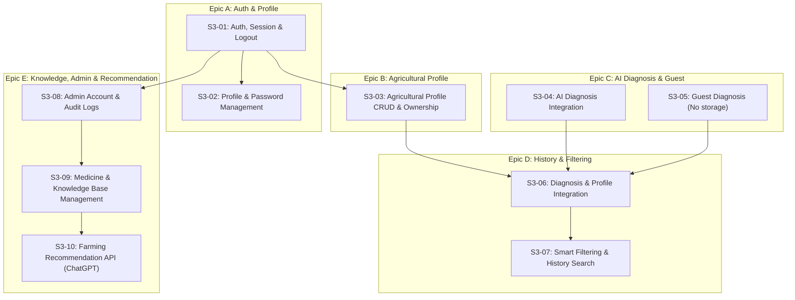

# Kế hoạch Triển khai Backend Improvement (AGRI-128) Theo Chuẩn Sprint 3 Backlog (S3-01 -> S3-10)

Nhánh: `AGRI-128-backend-improvement`  
Căn cứ: `database_details.md`, `writing-block.md` (Sprint 3 Jira Backlog S3-01 -> S3-10), mã nguồn hiện tại của Backend .NET 9.  
Quy ước triển khai chung: Xem [Quy ước triển khai Backend (Implementation Rules)](AGRI-128-implementation-rules.md).

Cập nhật 2026-10-21: task hồ sơ được người dùng xác nhận là **AGRI-116**, triển khai
backend S3-03 và chọn hồ sơ tùy chọn S3-06; giao diện ngoài phạm vi theo yêu cầu.
Xem [contract và bằng chứng AGRI-116](../reports/AGRI-116/agricultural_profiles.md).
Bảng hiện trạng bên dưới giữ baseline lập kế hoạch; không dùng làm trạng thái source mới nhất.

---

## 1. Bảng Đối chiếu Pipeline với 10 Task Backlog (S3-01 -> S3-10)

| Task ID | Tiêu đề Task trong Backlog | Hiện trạng Backend (.NET 9) | Yêu cầu bổ sung cụ thể trong Pipeline AGRI-128 |
|---|---|---|---|
| **S3-01** | User Authentication & Authorization | Đã có `RegisterAsync`, `LoginAsync` cơ bản; chưa có `LogoutAsync`, chưa kiểm tra `is_active`, chưa quản lý phiên `user_sessions`, chưa có audit log khi thao tác tài khoản. | - Thêm `LogoutAsync` thu hồi phiên trong `user_sessions`. - Kiểm tra `is_active` khi login. - Đảm bảo phân quyền nghiêm ngặt User/Admin/Guest. - Chuẩn hóa response lỗi xác thực. |
| **S3-02** | User Profile & Password Management | Chưa có endpoint và service cho Profile & Đổi mật khẩu. | - Thêm `GetProfileAsync`, `UpdateProfileAsync` (họ tên). - Thêm `ChangePasswordAsync` (so sánh hash mật khẩu cũ, kiểm tra độ mạnh, lưu hash mới). - Thu hồi phiên cũ khi đổi mật khẩu nếu cần. |
| **S3-03** | Agricultural Profile CRUD & Ownership | Database đã có bảng `agricultural_profiles` nhưng chưa có DTOs, Repository, Service hay Controller. | - Xây dựng đầy đủ CRUD `agricultural_profiles` theo sở hữu của User. - Kiểm tra quyền sở hữu khi xem/sửa/xóa. - Xóa hồ sơ thì set null liên kết trong chẩn đoán, không xóa bản ghi lịch sử. |
| **S3-04** | AI Plant Disease Diagnosis Workflow Integration | Đã có `PredictAsync` 1 ảnh gọi AI Service FastAPI; snapshot lưu vào `predictions`. | - Tiếp tục củng cố kiểm tra định dạng (.jpg, .jpeg, .png), kích thước. - Xử lý lỗi AI service timeout/fallback. - Đảm bảo confidence và warning khi confidence <= 80%. |
| **S3-05** | Guest Plant Disease Diagnosis | Controller đã hỗ trợ Guest không có `userId`. | - Đảm bảo Guest tra cứu AI đầy đủ nhưng **tuyệt đối không lưu bản ghi `predictions`, không tạo hồ sơ, không lưu ảnh lâu dài vào cloud storage**. - Chặn Guest truy cập các API yêu cầu xác thực. |
| **S3-06** | Diagnosis History & Agricultural Record Integration | Hiện tại chẩn đoán chưa cho nhận `agriculturalProfileId`. | - Mở rộng `PredictRequest` và `PredictAsync` nhận `agriculturalProfileId` tùy chọn. - Kiểm tra quyền sở hữu profile của User trước khi gắn. - Lưu snapshot JSONB bất biến, lưu ảnh với TTL 30 ngày. |
| **S3-07** | Smart Diagnosis History Filtering & Search | `GetPredictionHistoryAsync` mới chỉ phân trang cơ bản theo `userId`, chưa có bộ lọc. | - Xây dựng bộ lọc đa tiêu chí tại Database/EF Core: theo `plantId`, `diseaseId`, `agriculturalProfileId`, `fromDate`, `toDate`. - Sắp xếp ổn định theo `created_at DESC, id DESC`. - Phân trang chuẩn `pageNumber`, `pageSize`. |
| **S3-08** | Admin Account & Role Management | Chưa có API danh sách tài khoản, vô hiệu hóa tài khoản và ghi audit log. | - Xây dựng `AdminUsersController` và service quản trị tài khoản. - Tìm kiếm, lọc theo vai trò, trạng thái `is_active`. - Khóa/mở khóa tài khoản, điều chỉnh vai trò (`Admin`/`User`). - Ghi vết hành động quản trị vào bảng `admin_audit_logs`. |
| **S3-09** | Agricultural Knowledge Base & Medicine Management | Database đã có 4 bảng `medicines`, `medicine_uses`, `knowledge_documents`, `knowledge_document_plant_diseases` nhưng chưa có API. | - Xây dựng Repository, Service và Controller cho Admin CRUD danh mục thuốc BVTV & bài viết canh tác. - Áp dụng ràng buộc nghiệp vụ: chỉ công khai khi `is_approved = true` và `is_public = true`. - Thuốc phải gắn đúng cặp Cây - Bệnh (`medicine_uses`) và có xác minh nhãn (`is_label_verified = true`). - Cung cấp API tra cứu tài liệu/thuốc theo bệnh cho người dùng. |
| **S3-10** | Farming Recommendation API (Stretch Goal) | Chưa có API gợi ý canh tác/khuyến nghị. | - Xây dựng `FarmingAdvisorController` và `IFarmingAdvisorService`. - Tích hợp AI (OpenAI ChatGPT) kết hợp dữ liệu tri thức từ Knowledge Base/Database để đưa ra giải pháp canh tác, chăm sóc, phục hồi cho nông dân. - Có cơ chế Mock/Fallback thông minh nếu chưa có API key. |

---

## 2. Pipeline Chi tiết Cho Từng Task (S3-01 -> S3-10)

---

## 3. Danh mục Công việc Cụ thể (Action Items) Theo Từng Task

### Task S3-01: User Authentication, Session & Authorization
- [ ] Mở rộng `IAuthService` và `AuthService`:
  - Thêm phương thức `LogoutAsync(Guid userId, string token, CancellationToken ct)`.
  - Cập nhật `LoginAsync`: Kiểm tra cờ `user.IsActive == false` thì từ chối đăng nhập với thông báo rõ ràng (`AccountLockedException` hoặc 403 Forbidden).
  - Khởi tạo bản ghi `UserSession` trong database khi đăng nhập thành công.
- [ ] Thêm `IUserSessionRepository` và implementation để lưu vết phiên đăng nhập, thu hồi phiên khi logout.
- [ ] Cập nhật `AuthController`: Bổ sung endpoint `POST api/auth/logout`.

### Task S3-02: User Profile & Password Management
- [ ] Tạo DTOs trong `AgriVision.Application/DTOs/User/`:
  - `UserProfileDto`: thông tin hiển thị (id, email, fullName, role, createdAt).
  - `UpdateProfileRequest`: `FullName` (bắt buộc, không để trống).
  - `ChangePasswordRequest`: `CurrentPassword`, `NewPassword`, `ConfirmPassword`.
- [ ] Xây dựng `IUserService` & `UserService`:
  - `GetProfileAsync(Guid userId)`: lấy thông tin của chính mình.
  - `UpdateProfileAsync(Guid userId, UpdateProfileRequest request)`: kiểm tra và lưu họ tên mới.
  - `ChangePasswordAsync(Guid userId, ChangePasswordRequest request)`: xác minh mật khẩu hiện tại bằng `IPasswordHasher`, kiểm tra mật khẩu mới không trùng mật khẩu cũ, hash và lưu mật khẩu mới.
- [ ] Xây dựng `UsersController` (`api/users/profile`, `api/users/change-password`) được bảo vệ bởi `[Authorize]`.

### Task S3-03: Agricultural Profile CRUD & Ownership Management
- [ ] Tạo DTOs trong `AgriVision.Application/DTOs/AgriculturalProfile/`:
  - `CreateAgriculturalProfileDto`: `Name` (bắt buộc, trim không rỗng), `Description` (tùy chọn).
  - `UpdateAgriculturalProfileDto`: `Name`, `Description`.
  - `AgriculturalProfileDto`: `Id`, `UserId`, `Name`, `Description`, `CreatedAt`, `UpdatedAt`, `PredictionCount`.
- [ ] Tạo `IAgriculturalProfileRepository` & `AgriculturalProfileRepository`:
  - `GetByUserIdAsync(Guid userId, CancellationToken ct)`
  - `GetByIdAsync(Guid id, CancellationToken ct)`
  - `AddAsync`, `UpdateAsync`, `DeleteAsync`.
- [ ] Xây dựng `IAgriculturalProfileService` & `AgriculturalProfileService`:
  - Thực hiện các thao tác CRUD và kiểm tra quyền sở hữu (`profile.UserId == currentUserId`).
  - Khi xóa profile: Sử dụng hành vi `SET NULL` đối với `predictions.agricultural_profile_id`, bảo toàn lịch sử chẩn đoán.
- [ ] Xây dựng `AgriculturalProfilesController` (`api/agricultural-profiles`) với các route:
  - `GET api/agricultural-profiles`: Lấy danh sách vườn/hồ sơ của user hiện tại.
  - `GET api/agricultural-profiles/{id}`: Chi tiết hồ sơ.
  - `POST api/agricultural-profiles`: Tạo hồ sơ mới.
  - `PUT api/agricultural-profiles/{id}`: Cập nhật hồ sơ.
  - `DELETE api/agricultural-profiles/{id}`: Xóa hồ sơ (giữ nguyên lịch sử chẩn đoán).

### Task S3-04: AI Plant Disease Diagnosis Workflow Integration
- [ ] Kiểm tra và chuẩn hóa quy trình nhận ảnh trong `PredictionService`:
  - Kiểm tra định dạng (.jpg, .jpeg, .png) và dung lượng tối đa.
  - Gọi FastAPI ConvNeXt-Tiny service và map class index (0-58) với `plant_diseases`.
  - Cung cấp thông báo cảnh báo khi `confidence <= 0.8` ("Độ tin cậy thấp; cần kiểm tra lại kết quả.").
  - Kiểm tra trạng thái duyệt của bệnh (`is_content_approved`). Nếu chưa duyệt hiển thị "Thông tin đang được cập nhật".

### Task S3-05: Guest Plant Disease Diagnosis
- [ ] Đảm bảo luồng Guest an toàn:
  - Khi request không có token JWT (`userId == null`), hệ thống chỉ thực hiện suy luận AI và trả về kết quả `PredictionResultDto`.
  - **Tuyệt đối không lưu vào database** (không tạo bản ghi `Prediction`, `PredictionDetail`, `PredictionImage`).
  - **Không upload lưu trữ lâu dài lên cloud storage**.
  - Ngăn chặn Guest gọi vào các API quản lý hồ sơ, lịch sử, hoặc profile.

### Task S3-06: Diagnosis History & Agricultural Record Integration
- [ ] Cập nhật `PredictRequest`: Thêm trường tùy chọn `Guid? AgriculturalProfileId`.
- [ ] Cập nhật `IPredictionService.PredictAsync`:
  - Nếu có `agriculturalProfileId`, kiểm tra profile đó có tồn tại và thuộc về `userId` hay không.
  - Gắn `prediction.AgriculturalProfileId = agriculturalProfileId`.
  - Lưu snapshot kết quả đầy đủ vào cột `result_snapshot` (JSONB) để bảo toàn dữ liệu lịch sử ngay cả khi danh mục bệnh hoặc thuốc thay đổi.
  - Thiết lập TTL ảnh 30 ngày (`ExpiresAt = CreatedAt.AddDays(30)`).

### Task S3-07: Smart Diagnosis History Filtering & Search
- [ ] Tạo DTO `PredictionHistoryFilterParams`:
  - `Guid? AgriculturalProfileId`: Lọc theo hồ sơ vườn.
  - `Guid? PlantId`: Lọc theo loại cây trồng.
  - `Guid? DiseaseId`: Lọc theo loại bệnh.
  - `DateTime? FromDate`, `DateTime? ToDate`: Khoảng thời gian chẩn đoán.
  - `int PageNumber = 1`, `int PageSize = 10`.
- [ ] Nâng cấp `IPredictionRepository` và `PredictionRepository`:
  - Viết truy vấn IQueryable lọc đồng thời nhiều điều kiện trực tiếp tại database PostgreSQL.
  - Áp dụng các chỉ mục tối ưu đã có sẵn trong DB (`IX_predictions_user_id_agricultural_profile_id_created_at_id`, `IX_predictions_user_id_created_at_id`).
  - Sắp xếp ổn định: `.OrderByDescending(p => p.CreatedAt).ThenByDescending(p => p.Id)`.
- [ ] Nâng cấp `PredictionsController.GetHistory`: Nhận query parameters từ `PredictionHistoryFilterParams` và trả về `PagedResult<PredictionHistoryDto>`.

### Task S3-08: Admin Account & Role Management
- [ ] Tạo DTOs trong `AgriVision.Application/DTOs/Admin/`:
  - `AdminUserListItemDto`: id, fullName, email, role, isActive, emailVerifiedAt, createdAt, predictionCount.
  - `UpdateUserStatusRequest`: `IsActive` (bool).
  - `UpdateUserRoleRequest`: `Role` ("User" hoặc "Admin").
  - `AdminAuditLogDto`: id, actorEmail, targetEmail, action, occurredAt.
- [ ] Xây dựng `IAdminUserService` & `AdminUserService`:
  - `GetUsersAsync(string? search, string? role, bool? isActive, int pageNumber, int pageSize)`: Phân trang danh sách tài khoản.
  - `SetUserStatusAsync(Guid adminId, Guid targetUserId, bool isActive)`: Khóa/mở khóa tài khoản, ghi log vào `admin_audit_logs`. Khi khóa tài khoản, thu hồi toàn bộ `user_sessions` của user đó.
  - `SetUserRoleAsync(Guid adminId, Guid targetUserId, string newRole)`: Điều chỉnh vai trò, ghi log.
  - `GetAuditLogsAsync(int pageNumber, int pageSize)`: Xem lịch sử thao tác của Admin.
- [ ] Xây dựng `AdminUsersController` (`api/admin/users`) được bảo vệ bởi `[Authorize(Roles = UserRole.Admin)]`.

### Task S3-09: Agricultural Knowledge Base & Medicine Management
- [ ] Tạo DTOs trong `AgriVision.Application/DTOs/Knowledge/` và `Medicine/`:
  - `MedicineDto`, `CreateMedicineRequest`, `UpdateMedicineRequest`.
  - `MedicineUseDto`, `AssignMedicineUseRequest`.
  - `KnowledgeDocumentDto`, `CreateKnowledgeDocumentRequest`.
- [ ] Xây dựng Repository & Service cho Medicines và Knowledge Documents:
  - CRUD danh mục thuốc và bài viết cẩm nang canh tác.
  - Kiểm tra các ràng buộc:
    - Không thể public thuốc hoặc tài liệu nếu chưa được duyệt (`is_approved == true`).
    - Thuốc phải được liên kết đúng với cặp Cây - Bệnh (`medicine_uses`) và có xác minh nhãn (`is_label_verified`).
- [ ] Cung cấp Controller:
  - `AdminMedicinesController`, `AdminKnowledgeController`: Dành cho Admin quản lý nội dung.
  - `MedicinesController`, `KnowledgeController`: Dành cho User tra cứu tài liệu/thuốc hợp lệ đã duyệt theo bệnh cây trồng.
- [ ] Tích hợp gợi ý thuốc vào kết quả chẩn đoán: Nếu `confidence > 0.8` và tình trạng là `Disease`, tự động truy xuất các thuốc đã duyệt từ bảng `medicine_uses` để đính kèm vào snapshot kết quả.

### Task S3-10: Farming Recommendation API (Stretch Goal - ChatGPT Integration)
- [ ] Tạo DTOs trong `AgriVision.Application/DTOs/FarmingAdvisor/`:
  - `FarmingAdviceRequest`: `PredictionId` hoặc (`PlantName`, `DiseaseName`, `Symptoms`, `FarmNotes`).
  - `FarmingAdviceResponse`: `PlantName`, `DiseaseName`, `Summary`, `OrganicSolutions`, `ChemicalSolutions`, `PreventionSteps`, `SoilAndEnvironmentCare`, `SourceReferences`.
- [ ] Xây dựng `IFarmingAdvisorService`:
  - Prompt Engineering chuyên sâu: Hướng dẫn ChatGPT đóng vai trò chuyên gia nông nghiệp Việt Nam, tư vấn giải pháp canh tác hữu cơ, quy trình vệ sinh đồng ruộng, xử lý đất và khuyến nghị theo chuẩn an toàn sinh học.
  - Kết hợp dữ liệu từ `KnowledgeDocument` và `MedicineUse` của hệ thống để đưa vào context prompt.
  - Cấu hình linh hoạt: Sử dụng `OpenAIClient` khi có `OpenAI:ApiKey`; cung cấp `MockFarmingAdvisorService` thông minh dựa trên tri thức database khi chưa cấu hình Key (đảm bảo môi trường dev/CI luôn chạy mượt mà).
- [ ] Xây dựng `FarmingAdvisorController` (`POST api/farming-advisor/advice`).

---

## 4. Kế hoạch Kiểm thử & Duy trì CI Gate (Giai đoạn Verification)

1. **Unit Tests**:
   - `AgriculturalProfileServiceTests`: Test CRUD, ownership check, orphan retention.
   - `UserServiceTests`: Test profile view, update, change password hash verification.
   - `PredictionFilteringTests`: Test query filter logic, date boundaries, Guest no-op persistence.
   - `MedicineServiceTests`: Test approval constraints, label verification rules.
   - `FarmingAdvisorServiceTests`: Test prompt building & fallback response.
2. **Integration Tests**:
   - `AgriculturalProfilesEndpointTests`: Test gọi API với token User thật qua test server.
   - `HistoryFilteringEndpointTests`: Test kết hợp nhiều bộ lọc trên PostgreSQL.
   - `AdminAuthorizationEndpointTests`: Đảm bảo chỉ Admin mới vào được `api/admin/*`.
3. **Chỉ số Chất lượng**:
   - Duy trì Backend Branch Coverage $\ge$ **60%** (target 80%).
   - Kiểm tra không có rò rỉ credential/API Key (Gitleaks scan).
