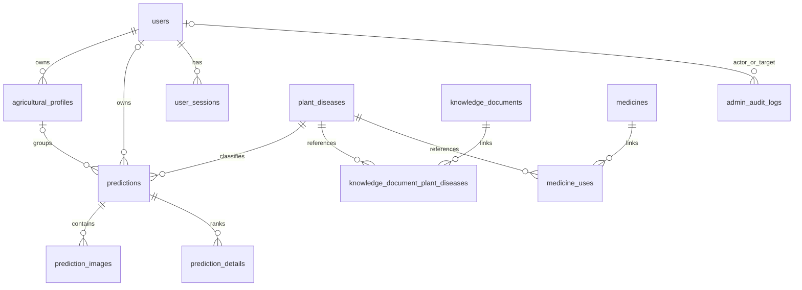

# AGRI-127 — Thiết kế dữ liệu và bàn giao triển khai

Ngày: 2026-10-17. Nhánh: `AGRI-127-database-improvement`.

## 1. Phạm vi đã được xác nhận qua phỏng vấn

AGRI-127 thực hiện DB, migration, kiểm thử và phần backend hiện có cần tương thích. **Không triển khai UI hoặc API tính năng mới.** Các US/subtask chỉ là nguồn yêu cầu; không nhận hoàn thành toàn bộ US-01 → US-10.

Các quyết định trực tiếp của người dùng trong phiên ngày 2026-10-17:

| Vấn đề | Quyết định áp dụng |
|---|---|
| Hồ sơ | Một tài khoản có nhiều hồ sơ, mỗi hồ sơ nhóm nhiều kết quả. Tên bắt buộc, mô tả tùy chọn; không có trường cây/bệnh bắt buộc, cây/bệnh lấy từ từng kết quả. |
| Tạo hồ sơ | App mời tạo sau đăng nhập và cho phép bỏ qua. Không có hồ sơ vẫn tự động lưu lịch sử theo tài khoản. Guest không tạo/chọn hồ sơ, không lưu lịch sử hoặc ảnh lâu dài. |
| Gắn kết quả | Chọn hồ sơ rồi thực hiện chẩn đoán; kết quả được gắn khi lưu lần đầu. Kết quả đã lưu không chuyển hồ sơ, không gắn lại sau khi bỏ liên kết, không gắn bổ sung lịch sử cũ. |
| Bỏ kết quả khỏi hồ sơ | Chỉ gỡ liên kết; vẫn giữ bản ghi trong lịch sử tài khoản. Ảnh hết hạn 30 ngày, vẫn giữ kết quả/snapshot. |
| Xóa hồ sơ | Xóa hồ sơ, gỡ liên kết các kết quả; không xóa lịch sử/snapshot/ảnh kèm theo. Ảnh tiếp tục vòng đời hết hạn hiện có. |
| Tri thức/thuốc | Gắn nhiều cặp cây–bệnh; có nguồn/ngày cập nhật. Bản mới mặc định chưa duyệt/chưa công khai; Admin duyệt thủ công, sửa nội dung phải duyệt lại. Thông tin nhãn và đối tượng dùng thuốc phải được xác minh. |
| Phiên | Vô hiệu hóa tài khoản/đổi quyền thu hồi mọi phiên hiện có; đăng xuất thu hồi phiên hiện tại. AGRI-127 chuẩn bị dữ liệu/ràng buộc, luồng API sẽ triển khai sau. |

Giữ các quyết định sản phẩm đã chốt trong `docs/confirmed_decisions.md`: email/mật khẩu + Google/verify/reset; nhiều ảnh cùng cặp nhãn mới có kết quả chung, confidence trung bình cộng; tổng dưới 30 MB; quy tắc thuốc/cảnh báo tại ngưỡng 80%; snapshot đầy đủ; giữ lịch sử sau khi ảnh hết hạn 30 ngày. Không thay đổi dataset v1.4, class mapping hoặc metric semantics.

## 2. Schema mới và dữ liệu giữ nguyên

Nguồn: [entities](../../../backend/src/AgriVision.Domain/Entities/), [configurations](../../../backend/src/AgriVision.Infrastructure/Persistence/Configurations/), [AppDbContext](../../../backend/src/AgriVision.Infrastructure/Persistence/AppDbContext.cs) và [snapshot](../../../backend/src/AgriVision.Infrastructure/Persistence/Migrations/AppDbContextModelSnapshot.cs).

Từ 9 lên **16 bảng nghiệp vụ**; `__EFMigrationsHistory` là bảng kỹ thuật, không tính trong số này.

| Bảng mới | Dữ liệu/ràng buộc chính |
|---|---|
| `agricultural_profiles` | User sở hữu, tên không rỗng, mô tả tùy chọn, ngày tạo/cập nhật. Chủ sở hữu không được chuyển. |
| `user_sessions` | ID phiên, user, ngày tạo/hết hạn/thu hồi; hết hạn sau thời điểm tạo; không lưu token thô. ID phiên sẽ được API tích hợp với JWT sau. |
| `admin_audit_logs` | Actor/target user, action và thời điểm; không có cột payload tự do chứa mật khẩu/token. Khi tài khoản bị xóa, giữ log và đặt FK về NULL. |
| `knowledge_documents` | Tiêu đề, nội dung, URL nguồn, ngày tạo/cập nhật, trạng thái duyệt/công khai/hoạt động. Công khai đòi hỏi đã duyệt và đang hoạt động. |
| `knowledge_document_plant_diseases` | Quan hệ nhiều–nhiều tài liệu ↔ cặp cây/bệnh chuẩn hóa; PK ghép chống trùng, FK từ chối lớp không tồn tại. |
| `medicines` | Tên sản phẩm, hoạt chất, đối tượng sử dụng, URL nguồn, cảnh báo, tham chiếu nhãn, ngày cập nhật và trạng thái duyệt/công khai/hiệu lực (`is_active`). Các trường nội dung bắt buộc không được rỗng. |
| `medicine_uses` | Quan hệ thuốc ↔ cặp cây/bệnh; hướng dẫn theo nhãn, trạng thái xác minh nhãn và duyệt. Không duyệt mục sử dụng khi nhãn chưa xác minh. |

Các thay đổi bảng hiện có:

- `users.is_active`: mặc định true, giữ tài khoản hiện hữu hoạt động. Không thay đổi email, password hash, role hoặc identity/token đang có.
- `predictions.agricultural_profile_id`: nullable, mặc định NULL cho lịch sử cũ; FK xóa hồ sơ → SET NULL. Không backfill hồ sơ giả hoặc thay snapshot cũ.
- Index lịch sử theo user/thời gian/ID và user/hồ sơ/thời gian/ID, index hồ sơ theo user/thời gian. Query/API lọc sẽ dùng các index này khi triển khai sau.
- Các bảng kết quả, ảnh, top-K, JSONB snapshot, Google identity, action token và catalog được dùng lại. Không thêm bảng khuyến nghị stretch và không nhập nội dung thuốc giả.

### Các ràng buộc bằng PostgreSQL trigger

- Hồ sơ chỉ được gắn tại INSERT kết quả, phải cùng chủ sở hữu; UPDATE chỉ cho giữ nguyên hoặc gỡ hồ sơ. Lịch sử không có hồ sơ vẫn hợp lệ.
- Giữ hành vi cũ khi xóa user: lịch sử còn, `user_id` và liên kết hồ sơ về NULL. Đây là tương thích FK cũ, không phải thêm chức năng xóa tài khoản.
- Đổi role hoặc chuyển tài khoản sang vô hiệu hóa thu hồi các session chưa thu hồi. Session của tài khoản vô hiệu hóa bị từ chối; lifetime/owner và trạng thái thu hồi hiện hữu không được sửa để hồi sinh phiên.
- Sửa nội dung/nguồn/trạng thái hoạt động của tài liệu hoặc thuốc đặt lại chưa duyệt/chưa công khai và cập nhật thời gian. Sửa thuốc còn hủy xác minh/duyệt các mục sử dụng; sửa cặp lớp/hướng dẫn của mục sử dụng cũng đòi xác minh/duyệt lại. Sửa liên kết tài liệu–cặp lớp đặt lại duyệt tài liệu.
- Đây là ràng buộc dữ liệu. Quyền Admin, xác thực URL/nguồn, giới hạn request và nội dung response vẫn phải được API thực thi sau; kết nối DB có quyền ghi không đại diện cho quyền người dùng ứng dụng.

### ERD phần mở rộng

Quan hệ users ↔ audit gồm hai FK độc lập actor/target. Sơ đồ chỉ thể hiện phần liên quan; không thay sơ đồ baseline cũ hoặc bỏ các bảng identity/action token.

## 3. Migration và cách áp dụng

Hai migration mới, không sửa ba migration lịch sử:

1. [20261017084014_DatabaseImprovement](../../../backend/src/AgriVision.Infrastructure/Persistence/Migrations/20261017084014_DatabaseImprovement.cs): trạng thái tài khoản, phiên, audit, tài liệu/thuốc và các trigger duyệt/thu hồi.
2. [20261017084202_OptionalAgriculturalProfiles](../../../backend/src/AgriVision.Infrastructure/Persistence/Migrations/20261017084202_OptionalAgriculturalProfiles.cs): hồ sơ tùy chọn, liên kết lịch sử và ràng buộc chủ sở hữu/không chuyển hồ sơ.

Hai migration forward-only để tránh downgrade làm mất dữ liệu mới; sửa lỗi bằng migration tiến tiếp. Backup phải có trước khi áp dụng cho DB có dữ liệu. Không đổi volume, drop/reset schema hoặc sửa `__EFMigrationsHistory` để vượt lỗi.

Quy trình backup/migrate: [database guide](../../../.agents/commands/database.md). HTTP startup chỉ kiểm tra schema; migration chạy riêng `--migrate`.

## 4. Bàn giao ngoài phạm vi DB

Toàn bộ việc UI/API, quyết định contract còn mở và xác minh chưa làm được quản lý
tại [remaining_work.md](../../notes/remaining_work.md). Đây là nguồn cập nhật trạng thái bàn giao;
không duy trì thêm một checklist song song trong tài liệu thiết kế.

## 5. Kiểm thử và bằng chứng

Bằng chứng của đợt triển khai DB ban đầu ngày 2026-10-17; giữ nguyên số đo của đợt
này. Các lần QA/gate sau nằm trong [README](README.md#bằng-chứng-local-theo-đợt).
Không đọc 33 + 44 bên dưới như số test mới nhất của toàn nhánh:

| Kiểm tra | Kết quả thực tế |
|---|---|
| `dotnet test backend/AgriVision.sln --no-restore --verbosity minimal --logger trx --results-directory .cache/database-verification/agri127/verified` | 33 unit + 44 integration passed, 0 failed/skip; trong đó 11 trường hợp DB mới. |
| `docker compose build backend` | Build/publish image .NET 9 thành công. |
| Baseline local | 3 migration/9 bảng nghiệp vụ, 59 lớp active; 0 user/prediction/ảnh. |
| Backup | Custom-format dump trong `.cache/database-verification/agri127/`; `pg_restore --list` đọc archive thành công. Chưa thực hiện restore backup. |
| `docker compose run --rm --no-deps backend --migrate` | Áp dụng hai migration mới, không chạy HTTP. |
| Chạy lại `--migrate` | Thành công, báo DB đã up to date và không áp dụng migration mới. |
| Sau migration local | 5 migration, 16 bảng nghiệp vụ, 59 lớp active; count/checksum dữ liệu ở các cột cũ của 9 bảng ban đầu giữ nguyên. |

DB local ban đầu rỗng user/history; bảo toàn dữ liệu được kiểm tra thêm bằng fixture PostgreSQL trong MigrationTests/CatalogImportTests. Evidence gốc `.cache/database-verification/agri127/`; các đợt sau xem [README](README.md).
