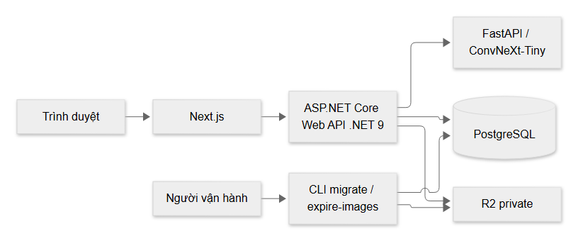
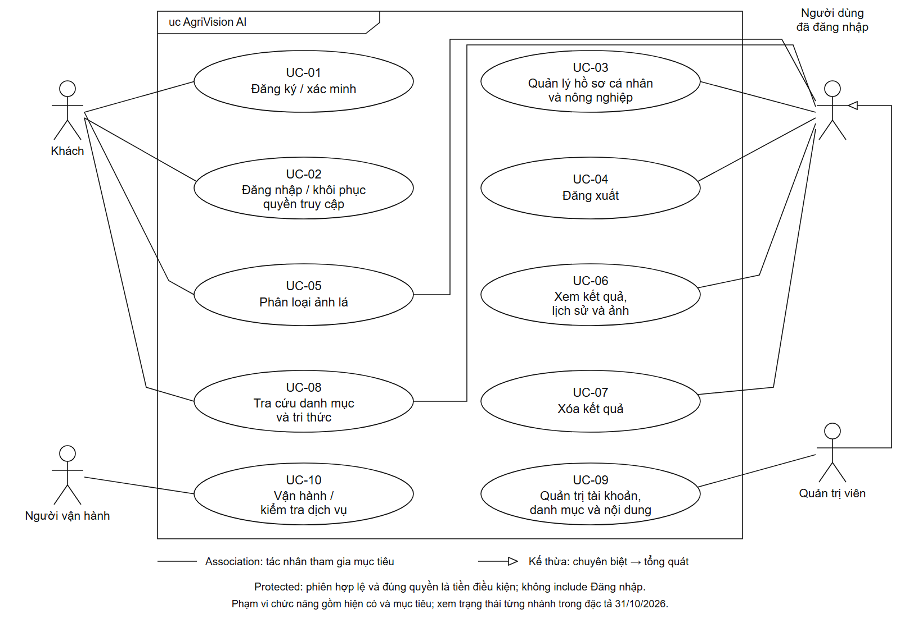
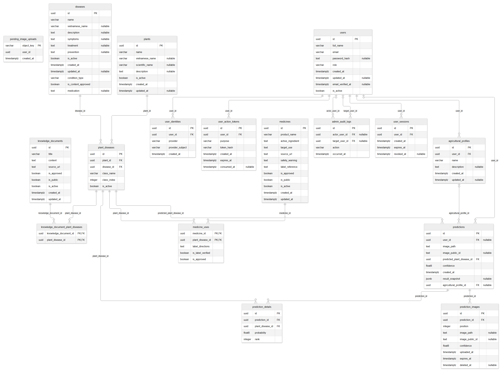

# BÁO CÁO PHÂN TÍCH HỆ THỐNG

**Dự án:** AgriVision AI

**Mã công việc:** AGRI-131

**Ngày biên soạn lại:** 31/10/2026

**Tài liệu nguồn:** Phân tích yêu cầu và thiết kế hệ thống — buổi thực hành 2 (`bao_cao_phan_tich_he_thong.html`, bản HTML lưu cục bộ).

Báo cáo trình bày mục tiêu, phạm vi, yêu cầu chức năng và phi chức năng, kiến trúc, các use case và mô hình dữ liệu của hệ thống AgriVision AI.

> Các nhận định về mã nguồn, cấu trúc dữ liệu và trạng thái triển khai trong báo cáo được giữ theo tài liệu HTML nguồn tại mốc đối chiếu 31/10. Việc biên soạn lại chỉ chuyển đổi và tổ chức nội dung; không bổ sung bằng chứng kiểm thử hay xác nhận nghiệm thu chức năng. Các sơ đồ được sao chép từ tài nguyên AGRI-76 và đóng gói cùng báo cáo trong `assets/session_2/`.

## 1. Xác định và đặc tả yêu cầu

### 1.1. Mục tiêu, phạm vi và thuật ngữ

AgriVision hỗ trợ nhà nông, người làm nông nghiệp và sinh viên phân loại loại cây/tình trạng từ ảnh lá, tra cứu hướng xử lý có kiểm duyệt và lưu kết quả cá nhân. Kết quả mang tính tham khảo. Chất lượng mô hình cần bằng chứng đánh giá riêng, không suy từ health check hoặc mock.

Phạm vi giữ **dataset v1.4, 59 cặp nhãn chuẩn**, 10 cây: cà chua, cà phê, cam, chè, lúa, ngô, nho, ớt, sầu riêng, xoài; ConvNeXt-Tiny. Kiến trúc: Next.js → ASP.NET Core Web API (.NET 9) → PostgreSQL; API gọi FastAPI, ảnh tài khoản lưu R2 private. Không bao gồm detection, segmentation, ước lượng mức độ nặng, giải thích nguyên nhân bằng mô hình hoặc tự sinh thuốc/phác đồ.

- **Prediction:** một lượt có một kết quả chung; `prediction_details` là top-k, không phải danh sách ảnh.
- **Hồ sơ cá nhân:** tên/thông tin tài khoản; khác **hồ sơ nông nghiệp** dùng để nhóm nhiều prediction.
- **Snapshot:** nội dung đã trả tại thời điểm dự đoán; vẫn giữ khi ảnh hết hạn hoặc danh mục thay đổi.
- **Hiện có:** quan sát trong source/schema; **mục tiêu:** yêu cầu cần triển khai/kiểm chứng; không phải nhãn nghiệm thu.

### 1.2. Tác nhân và quyền

| Tác nhân | Quyền và giới hạn |
| --- | --- |
| Khách | Đăng ký/đăng nhập, tra cứu danh mục public, dự đoán lượt hiện tại; không tạo/chọn hồ sơ nông nghiệp, không lưu ảnh hoặc lịch sử tài khoản. Header xác thực sai phải bị từ chối, không âm thầm chuyển thành khách. |
| Người dùng | Quyền khách; sửa hồ sơ cá nhân, đổi mật khẩu, CRUD hồ sơ nông nghiệp của mình; tự lưu, xem/lọc/xóa lịch sử của mình; đọc ảnh qua API có kiểm owner; đăng xuất phiên hiện tại. |
| Admin | Quản trị tài khoản/trạng thái/quyền và audit; quản trị danh mục. Có quyền xóa prediction theo code hiện tại, nhưng không được mặc định đọc ảnh/lịch sử riêng của người khác. CRUD/duyệt tri thức, thuốc là mục tiêu có schema, chưa có controller tương ứng. |
| Người vận hành | Backup, chạy migration/cleanup riêng và giám sát. Không phải giá trị role nghiệp vụ trong `users`. |
| FastAPI / R2 | Dịch vụ được backend gọi để suy luận / lưu đọc xóa object; không cấp credential R2 cho trình duyệt. |

### 1.3. Yêu cầu chức năng và tiêu chí chấp nhận

Giữ mã FR-01–09 cũ để truy vết; FR-10–13 bổ sung cho yêu cầu đã có trong các báo cáo mới. Các tiêu chí dưới là điều kiện cần kiểm chứng, không phải kết quả chạy test trong lần cập nhật tài liệu.

| ID | Yêu cầu và tiêu chí chấp nhận | Đối chiếu 31/10 |
| --- | --- | --- |
| FR-01 | Đăng ký email/mật khẩu; email duy nhất; chỉ lưu hash. Mục tiêu xác minh email, quên/reset bằng token hash có hạn, dùng một lần. Lỗi tạo phiên/token khi đăng ký phải rollback user và session. | Register nguyên tử có source; verify/reset mới có bảng hỗ trợ, chưa có endpoint. |
| FR-02 | Đăng nhập email/mật khẩu; tạo phiên có hạn gắn `sid` trong JWT. API bảo vệ kiểm tài khoản active, role, chủ phiên, expiry/revoked. Logout chỉ thu hồi phiên hiện tại. Google là mục tiêu; không tự liên kết identity theo email chưa xác minh. | Login/logout và kiểm phiên có source; Google chưa có endpoint. |
| FR-03 | Đọc/sửa hồ sơ cá nhân của mình; cập nhật họ tên, không tự đổi email/role qua endpoint hồ sơ. Đổi mật khẩu yêu cầu mật khẩu hiện tại và xác nhận mới; thành công thu hồi mọi phiên. | GET/PUT `/api/users/profile`, POST `/api/users/change-password`; tên trim bắt buộc, tối đa 60 ký tự; mật khẩu mới tối thiểu 6 ký tự theo code, không coi là chính sách mục tiêu đã chốt đầy đủ. |
| FR-04 | Nhận JPG/JPEG/PNG; tự nhận cây và tình trạng. Mục tiêu một/nhiều ảnh, tổng dưới 30 MB; chỉ gộp khi mọi ảnh cùng cặp nhãn, confidence trung bình cộng; khác nhãn hoặc ngoài phạm vi/không phải lá phải từ chối. | Contract hiện tại một `file`, tối đa 15 MiB; nhiều ảnh và cơ chế từ chối ngoài phạm vi chưa được nghiệm thu. Không thay mục tiêu 30 MB bằng cấu hình một ảnh. |
| FR-05 | Trả cây, tình trạng, confidence, cảnh báo và nội dung đúng nhãn đã duyệt. Confidence ≤80% có cảnh báo, không thuốc; >80% + bệnh mới được phép trả thuốc hợp lệ đã duyệt. Khỏe/thiếu dinh dưỡng chỉ chăm sóc. Thiếu nội dung: “Thông tin đang được cập nhật”. | Có quy tắc kết quả/snapshot; tích hợp nguồn knowledge/medicine mới còn phải hoàn thiện. Không tự sinh nội dung. |
| FR-06 | User dự đoán thành công tự lưu chủ sở hữu, ảnh, top-k, thời gian và snapshot; không cần hồ sơ nông nghiệp. Guest trả kết quả nhưng không persist. AI/mapping lỗi không tạo kết quả thành công; lỗi DB/storage phải có đường cleanup. | Guest 200, user 201; journal upload và snapshot có source. |
| FR-07 | List/detail/lọc/phân trang lịch sử theo owner; đọc ảnh cũng kiểm owner, expiry, deleted. User A không đọc/xóa dữ liệu B. Xóa prediction phải xử lý ảnh và quan hệ con theo thiết kế; lỗi storage không báo xóa thành công giả. | GET list/detail/image và DELETE có source; list lọc hồ sơ/cây/bệnh/ngày. Admin có ngoại lệ DELETE, không có ngoại lệ đọc ảnh. |
| FR-08 | Admin tìm/xem tài khoản, đổi active/role, ghi audit actor/target/action/time cùng giao dịch; thay active→false hoặc role phải thu hồi phiên. Không ghi password/token vào audit. | `/api/admin/users`, status/role, audit có source; không suy thành quyền đọc mọi dữ liệu cá nhân hoặc xóa cứng tài khoản. |
| FR-09 | Tra cứu danh mục public; tạo/sửa/ngừng dùng cây/bệnh chỉ Admin. Bảo toàn lớp đang được lịch sử tham chiếu; không thay mapping nhãn vì sửa UI. | Controller cây/bệnh có source; DELETE dùng soft-delete. Popup xác nhận và xóa cứng tài khoản vẫn chưa chốt. |
| FR-10 | Một user có nhiều hồ sơ nông nghiệp, tên bắt buộc/mô tả tùy chọn. Mời tạo sau login và cho bỏ qua. Chỉ chọn hồ sơ của mình khi tạo prediction; không chuyển/gắn lại/bổ sung lịch sử cũ. Gỡ liên kết hoặc xóa hồ sơ giữ prediction/snapshot/ảnh và TTL. | CRUD API và FK nullable có; trigger giới hạn owner/gắn ban đầu. Chưa có API gỡ riêng; trải nghiệm lời mời/UI cần kiểm chứng riêng. |
| FR-11 | Tài liệu tri thức gắn nhiều cặp cây–bệnh, có nguồn và ngày cập nhật. Mới mặc định chưa duyệt/chưa public; Admin duyệt, chỉ public khi active + approved + public. Sửa nội dung/nguồn/liên kết phải duyệt lại. | Có bảng, CHECK và trigger; chưa có controller CRUD/duyệt tài liệu. |
| FR-12 | Thuốc có sản phẩm, hoạt chất, đối tượng, nguồn, cảnh báo, nhãn; mỗi mục sử dụng gắn đúng cặp cây–bệnh, hướng dẫn theo nhãn đã xác minh và duyệt. Sửa thuốc/hướng dẫn/liên kết phải xác minh/duyệt lại theo trigger. | Có `medicines`/`medicine_uses`; chưa có controller CRUD/duyệt thuốc. Nội dung legacy `diseases.medication` không tự trở thành thuốc có nguồn đã xác minh. |
| FR-13 | Ảnh private lưu key R2; dự trữ intent trước upload, kết thúc intent sau persist/cleanup được xác nhận. Cleanup xử lý ảnh hết hạn và intent stale; giữ history/snapshot khi expiry. Migration chạy riêng `--migrate`, HTTP chỉ kiểm pending migration. | `pending_image_uploads`, R2 adapter và `--expire-images` có source; chưa scheduler. |

### 1.4. Yêu cầu phi chức năng

| ID | Yêu cầu | Tiêu chí kiểm chứng / giới hạn |
| --- | --- | --- |
| NFR-01 | Bảo mật tài khoản và phân quyền | JWT hợp lệ và session còn hiệu lực; A/B owner tests cho history/profile/image; User bị chặn endpoint Admin. Hash mật khẩu, hash action token; secret ngoài Git/frontend; audit không chứa secret. |
| NFR-02 | An toàn và riêng tư ảnh | JPEG/PNG hợp lệ, chặn payload quá giới hạn; R2 private, đọc qua JWT API, no-store/nosniff; không fallback local khi R2 lỗi. Kiểm decoder và ngoài phạm vi cần evidence riêng. |
| NFR-03 | Vòng đời và bảo toàn dữ liệu | Ảnh hết hạn sau 30 ngày từ upload, ẩn URL và xóa object theo cleanup; giữ snapshot/history. Gỡ/xóa hồ sơ không xóa prediction. Không chạy cleanup như health check. |
| NFR-04 | Hiệu năng và tài nguyên | Chặn request vượt rate/concurrency/quota cấu hình. Mặc định hiện tại: prediction 10/phút, image 60/phút, auth 10/phút, concurrency chung 8, 100 ảnh/intents/user, 15 MiB/ảnh; xem source protection/journal. SLA latency và tải mục tiêu chưa chốt; các giới hạn này không chứng minh SLA. |
| NFR-05 | Tính nhất quán suy luận | Dataset v1.4, mapping 59 lớp, preprocessing và metric semantics nhất quán CLI–HTTP–API; index/name top-1/top-k phải khớp catalog. Tách test double, checkpoint smoke, đánh giá held-out và E2E. |
| NFR-06 | Truy vết | Lưu thời gian UTC, owner, top-k, snapshot và audit đúng phạm vi; schema chưa có cột model/dataset version trên prediction. Không tự điền version lịch sử suy đoán. |
| NFR-07 | Toàn vẹn và đồng thời | Dùng FK/CHECK/unique/trigger, transaction đăng ký và thao tác quản trị; login/đổi mật khẩu phối hợp khóa user; quota khóa user trước reserve. Phiên bị thu hồi không được hồi sinh. |
| NFR-08 | Vận hành và phục hồi | Giữ migration history/volume; backup trước migration, migration forward-only khi có quy định; thử restore trên DB riêng trước tuyên bố phục hồi đạt. Startup không tự migrate/seed; scheduler/backup cadence chưa chốt. |
| NFR-09 | Khả dụng giao diện | Có loading/error/retry, thông báo thiếu nội dung, trạng thái ảnh hết hạn, phân biệt Guest/User; kiểm responsive và truy cập bàn phím khi nghiệm thu UI. Chưa có ngưỡng accessibility/SLA được nhóm chốt. |

## 2. Thiết kế hệ thống

### 2.1. Kiến trúc và ranh giới

API chịu trách nhiệm auth/session/owner, validation, mapping catalog, snapshot và điều phối storage. FastAPI trả nhãn/confidence; không ghi DB ứng dụng. PostgreSQL giữ metadata và nội dung, R2 giữ byte ảnh. Browser lấy ảnh bằng API có JWT, không lấy credential hoặc URL bucket public. Không có Cloudinary/local fallback trong adapter hiện tại. CLI chỉ được chạy khi có quyền vận hành; `--expire-images` xóa ảnh thật.

### 2.2. Sơ đồ Use Case UML

Các use case dưới đây mô tả tác nhân, yêu cầu liên quan, tiền điều kiện, luồng xử lý, nhánh ngoại lệ và hậu điều kiện.

#### UC-01 — Đăng ký / xác minh

- **Tác nhân:** Khách.
- **Yêu cầu:** FR-01.
- **Tiền điều kiện:** Chưa đăng nhập; email hợp lệ, chưa trùng.
- **Luồng chính:** Nhập email/mật khẩu → kiểm dữ liệu → transaction tạo user/hash, tạo session và JWT → commit → trả kết quả.
- **Nhánh thay thế và ngoại lệ:** Trùng email hoặc lỗi session/token/cancel: không để user/session đăng ký dở. Verify email là nhánh mục tiêu: kiểm token hash/expiry/consumed trước cập nhật verified.
- **Hậu điều kiện:** User/session được lưu nguyên tử; không lộ hash/token thao tác.
- **Nguồn và trạng thái:** AuthController/AuthService; user_action_tokens mới hỗ trợ schema verify/reset.

#### UC-02 — Đăng nhập / khôi phục quyền truy cập

- **Tác nhân:** Khách (bao gồm người đã có tài khoản trước khi đăng nhập).
- **Yêu cầu:** FR-02.
- **Tiền điều kiện:** Tài khoản tồn tại, active; login email/password đúng.
- **Luồng chính:** Khóa user trong transaction → kiểm hash/active → tạo session → cấp JWT có sid → commit; request sau kiểm session/owner/expiry/revoked. Restore qua auth/me.
- **Nhánh thay thế và ngoại lệ:** Sai mật khẩu/inactive/phiên thu hồi trả lỗi; token sai không được chuyển thành Guest. Google và quên/reset là nhánh mục tiêu, không có endpoint hiện tại.
- **Hậu điều kiện:** Phiên có hạn được lưu, mật khẩu không trả client.
- **Nguồn và trạng thái:** AuthController/AuthService, Program; identity/action token có schema, chưa có workflow đầy đủ.

#### UC-03 — Quản lý hồ sơ cá nhân và nông nghiệp

- **Tác nhân:** User.
- **Yêu cầu:** FR-03, FR-10.
- **Tiền điều kiện:** JWT/session hợp lệ; thao tác trên dữ liệu của mình.
- **Luồng chính:** Đọc/sửa tên cá nhân hoặc đổi mật khẩu; CRUD hồ sơ nông nghiệp tên bắt buộc/mô tả tùy chọn. Khi tạo prediction chọn hồ sơ tùy ý; xóa hồ sơ gỡ FK, giữ history/ảnh.
- **Nhánh thay thế và ngoại lệ:** Sai owner/không tồn tại: 404; Guest: 401. Đổi mật khẩu sai current/confirm bị từ chối; đúng thì revoke mọi session. Không chuyển hoặc gắn lại prediction cũ; chưa có API gỡ riêng.
- **Hậu điều kiện:** Thay đổi lưu server; không tự đổi role/email. Không xóa prediction khi xóa hồ sơ.
- **Nguồn và trạng thái:** UsersController/UserService, AgriculturalProfilesController; lời mời tạo hồ sơ/bỏ qua là yêu cầu UI cần nghiệm thu.

#### UC-04 — Đăng xuất

- **Tác nhân:** User.
- **Yêu cầu:** FR-02.
- **Tiền điều kiện:** JWT hợp lệ với sid thuộc user.
- **Luồng chính:** Gọi POST /api/auth/logout → revoke đúng userId/sid → client bỏ phiên.
- **Nhánh thay thế và ngoại lệ:** Token không hợp lệ bị từ chối; không dùng logout một phiên để thu hồi phiên khác.
- **Hậu điều kiện:** Phiên hiện tại không dùng lại được; phiên thiết bị khác giữ nguyên nếu không có sự kiện thu hồi toàn bộ.
- **Nguồn và trạng thái:** AuthController/AuthService; khác baseline logout chỉ ở browser.

#### UC-05 — Phân loại ảnh lá

- **Tác nhân:** Guest / User.
- **Yêu cầu:** FR-04, FR-06, FR-10, FR-13.
- **Tiền điều kiện:** Input hợp lệ; User chọn profile phải sở hữu; auth header nếu có phải hợp lệ.
- **Luồng chính:** Kiểm ảnh → gọi AI → kiểm mapping top-1/top-k → Guest trả 200 không persist; User reserve journal → PUT R2 → lưu prediction/images/details/snapshot → complete intent → 201.
- **Nhánh thay thế và ngoại lệ:** Guest truyền profile bị 401; profile người khác 404; lỗi AI/mapping không upload; lỗi persist/storage cleanup hoặc giữ journal để reconcile. Mục tiêu multi-image chỉ gộp cùng cặp nhãn, trung bình confidence.
- **Hậu điều kiện:** Guest không history/ảnh lâu dài; User có history và snapshot khi thành công.
- **Nguồn và trạng thái:** PredictionsController/PredictionService; hiện một file 15 MiB, multi-image/out-of-scope cần triển khai hoặc nghiệm thu riêng.

#### UC-06 — Xem kết quả, lịch sử và ảnh

- **Tác nhân:** Guest (kết quả tức thời) / User.
- **Yêu cầu:** FR-05, FR-07.
- **Tiền điều kiện:** Guest có DTO lượt hiện tại; đọc history/ảnh cần JWT/session và owner.
- **Luồng chính:** Hiện kết quả/cảnh báo/nội dung; User list/filter/page → detail → ảnh private qua API. Ưu tiên snapshot lịch sử; metadata expiry quyết định có ảnh.
- **Nhánh thay thế và ngoại lệ:** Owner sai/missing/ảnh hết hạn trả 404; Guest history trả 401. ≤80% cảnh báo, không thuốc; thiếu nội dung dùng chuỗi đã chốt.
- **Hậu điều kiện:** Không sửa snapshot theo kho nội dung mới, không trả URL ảnh đã hết hạn hoặc dữ liệu người khác.
- **Nguồn và trạng thái:** PredictionsController/PredictionService; snapshot legacy NULL không được tạo dữ liệu lịch sử giả.

#### UC-07 — Xóa kết quả

- **Tác nhân:** User / Admin.
- **Yêu cầu:** FR-07.
- **Tiền điều kiện:** JWT/session; owner hoặc ngoại lệ Admin DELETE theo code.
- **Luồng chính:** Đọc prediction có quyền → xử lý storage → xóa prediction, cascade images/details.
- **Nhánh thay thế và ngoại lệ:** Storage thất bại: không báo xóa thành công; sai quyền/missing theo source. Popup xác nhận là quyết định còn mở.
- **Hậu điều kiện:** Không còn prediction đã xóa; hồ sơ nông nghiệp không bị xóa theo.
- **Nguồn và trạng thái:** PredictionService.DeletePredictionAsync; không nhầm xóa prediction với expiry (giữ history).

#### UC-08 — Tra cứu danh mục và tri thức

- **Tác nhân:** Guest / User.
- **Yêu cầu:** FR-05, FR-09, FR-11, FR-12.
- **Tiền điều kiện:** Catalog public; nội dung chỉ public khi đủ điều kiện.
- **Luồng chính:** Tra cây/bệnh; mục tiêu đọc tài liệu/thuốc có nguồn, active/approved/public và mục sử dụng đúng nhãn đã verified/approved.
- **Nhánh thay thế và ngoại lệ:** Nội dung thiếu/chưa duyệt: không trả thuốc trái điều kiện; hiển thị thông báo cập nhật khi cần.
- **Hậu điều kiện:** Không lộ nội dung chưa được phép công khai.
- **Nguồn và trạng thái:** PlantsController/DiseasesController có; controllers knowledge/medicine chưa có, cần hoàn thiện đọc public và nối kết quả.

#### UC-09 — Quản trị tài khoản, danh mục và nội dung

- **Tác nhân:** Admin.
- **Yêu cầu:** FR-08, FR-09, FR-11, FR-12.
- **Tiền điều kiện:** JWT/session có role Admin; tài nguyên mục tiêu hợp lệ.
- **Luồng chính:** Tìm/xem user; đổi status/role kèm audit và revoke session; CRUD/soft-delete cây/bệnh. Mục tiêu CRUD/duyệt tài liệu/thuốc, sửa thì duyệt lại.
- **Nhánh thay thế và ngoại lệ:** User thường bị 403; không suy quyền đọc ảnh riêng từ role Admin; kiểm constraint, bảo vệ thao tác quyền theo AdminUserService.
- **Hậu điều kiện:** Audit không chứa secret; dữ liệu tham chiếu được bảo toàn; không công khai nội dung sửa chưa duyệt.
- **Nguồn và trạng thái:** AdminUsersController/AdminUserService/PlantsController/DiseasesController có; workflow tri thức/thuốc mới có schema.

#### UC-10 — Vận hành và kiểm tra dịch vụ

- **Tác nhân:** Người vận hành.
- **Yêu cầu:** FR-13.
- **Tiền điều kiện:** Đúng môi trường và quyền vận hành; backup trước migration DB có dữ liệu.
- **Luồng chính:** Health kiểm DB/AI riêng; --migrate áp dụng migration không HTTP; --expire-images xóa ảnh expired và reconcile intent stale, giữ history/snapshot.
- **Nhánh thay thế và ngoại lệ:** Pending migration ngăn startup; lỗi storage giữ metadata/intent để retry; không drop volume/reset history; không tự downgrade forward-only.
- **Hậu điều kiện:** Schema có lịch sử đúng; cleanup không xóa snapshot; không suy health thành nghiệm thu inference.
- **Nguồn và trạng thái:** Program/ImageExpiryCleanup/ImageUploadJournal; chưa scheduler hoặc restore verification mới trong lần tài liệu này.

### 2.3. Mô hình dữ liệu và sơ đồ ERD

`PK,FK` chỉ cột thuộc cả PK ghép và FK. `nullable` thể hiện FK/thuộc tính tùy chọn; đầu cha `|o` là 0..1, `||` là đúng 1; phía con `o{` là 0..n. Cardinality không thay ràng buộc owner/trigger. Journal `pending_image_uploads` đứng riêng vì `user_id` chưa có FK vật lý.

