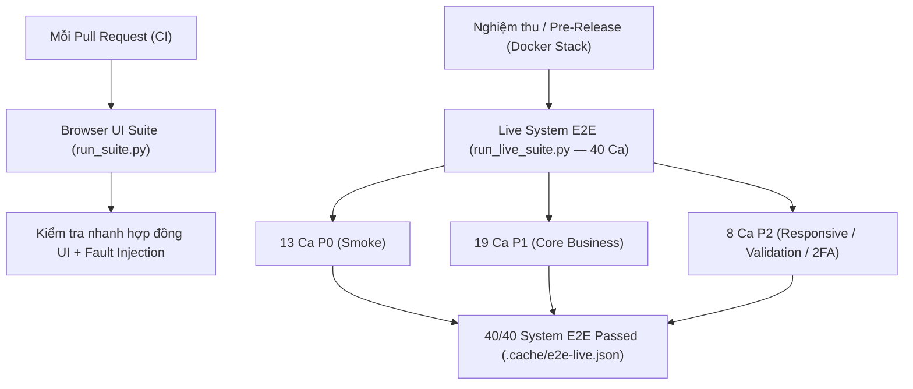

# Đặc tả ma trận kiểm thử E2E Tự động (Automated System E2E) — AgriVision AI

Tài liệu kỹ thuật thuộc nhánh nhiệm vụ **AGRI-145**. Tài liệu này chỉ đặc tả **40 ca kiểm thử E2E tự động (Automated System E2E)** chạy xuyên suốt từ giao diện Next.js $\rightarrow$ ASP.NET Core Web API (.NET 9) $\rightarrow$ PostgreSQL (`agrivision_db`), dịch vụ AI ConvNeXt-Tiny (FastAPI) và Mailpit SMTP trên Docker stack thật (`frontend/tests/browser/e2e/run_live_suite.py`).

Các ca kiểm thử thủ công (Manual E2E) được tách riêng hoàn toàn tại [manual_e2e_test_cases.md](manual_e2e_test_cases.md).

---

## 1. Bối cảnh & Cơ sở thiết kế

### 1.1. Phân định System E2E và Browser UI Test
Theo quy chuẩn tại mục 9 của [TESTING.md](../../TESTING.md#L140):
> *"Browser chạy với mock API là browser UI test; chỉ gọi là E2E toàn hệ thống khi đi qua các thành phần thật trong phạm vi đã công bố."*

- **Automated System E2E (40 ca trong tài liệu này):** Thực thi qua `frontend/tests/browser/e2e/run_live_suite.py` (`live_*.py`) không chặn mock API, đi qua Docker stack thật (`postgres`, `ai-service`, `backend`, `frontend`, `mailpit`).
- **Browser UI Test (`run_suite.py`):** Chạy với `ApiStub` để kiểm tra nhanh hợp đồng giao diện và các trạng thái giả lập lỗi trên CI.
- **Manual E2E:** Tách riêng sang [manual_e2e_test_cases.md](manual_e2e_test_cases.md), không trộn chung trong tài liệu này.

### 1.2. Mục tiêu bộ kiểm thử System E2E
Bộ kiểm thử 40 ca System E2E bảo vệ:
1. **Hành trình người dùng (User Journeys):** Đăng ký, đăng nhập, quên mật khẩu/OTP, 2FA, đổi mật khẩu, tải ảnh chẩn đoán bệnh, lưu trữ và theo dõi lịch sử, quản lý hồ sơ mùa vụ.
2. **Quy tắc nghiệp vụ cốt lõi:** Hiển thị kết quả chẩn đoán AI (FR-04, FR-05), chính sách không lưu lịch sử đối với Khách (FR-06), phân quyền cổng quản trị Admin và CRUD danh mục (FR-08).
3. **Tính toàn vẹn dữ liệu (Data Persistence & Round-trip):** Dữ liệu thao tác từ giao diện được ghi nhận vào PostgreSQL/storage thật và hiển thị lại nhất quán sau khi reload hoặc điều hướng.

---

## 2. Tổng quan phân bổ 40 Ca Automated System E2E

| STT | Phân hệ chức năng | Mã yêu cầu | P0 (Smoke) | P1 (Core) | P2 (Edge) | Tổng số ca | Live Runner (`frontend/tests/browser/e2e/`) |
|:---:|---|---|:---:|:---:|:---:|:---:|---|
| 1 | Xác thực & Quản lý phiên | FR-01, FR-02, NFR-01 | 3 | 3 | 1 | **7** | `live_account.py`, `live_diagnosis.py`, `live_email_auth.py`, `live_smoke.py` |
| 2 | Hồ sơ cá nhân & Cài đặt | FR-03, AGRI-132 | 1 | 2 | 1 | **4** | `live_account.py`, `live_email_auth.py` |
| 3 | Chẩn đoán bệnh AI | FR-04, FR-05, FR-06 | 3 | 1 | 1 | **5** | `live_smoke.py`, `live_diagnosis.py` |
| 4 | Lịch sử chẩn đoán | FR-07, FR-09, NFR-01 | 2 | 1 | 1 | **4** | `live_diagnosis.py`, `live_account.py` |
| 5 | Hồ sơ nông nghiệp | AGRI-116, FR-03 | 1 | 2 | 0 | **3** | `live_agricultural_profile.py`, `live_prediction_profile.py` |
| 6 | Cẩm nang & Danh mục công khai | AGRI-128, AGRI-134, AGRI-140 | 1 | 3 | 0 | **4** | `live_smoke.py` |
| 7 | Cổng quản trị CRM | FR-08, AGRI-80, AGRI-142 | 2 | 4 | 0 | **6** | `live_admin.py`, `live_catalog_admin.py` |
| 8 | Điều hướng, Responsive & Phục hồi | NFR-04, UX Standards | 0 | 1 | 2 | **3** | `live_smoke.py` |
| 9 | Trang chủ (Homepage) | Navigation, Hero, Reduced Motion | 0 | 2 | 2 | **4** | `live_smoke.py` |
| | **TỔNG CỘNG** | | **13** | **19** | **8** | **40** | `run_live_suite.py` (**40/40 Passed**) |

---

## 3. Ma trận chi tiết 40 Ca kiểm thử Automated System E2E

### Phân hệ 1: Xác thực & Quản lý phiên (Authentication & Sessions) — 7 ca
*Bao phủ: FR-01 (Đăng ký/Xác minh), FR-02 (Đăng nhập/Đăng xuất), NFR-01 (Bảo mật).*

| Mã Test | Ưu tiên | Tiêu đề kịch bản | Tiền điều kiện | Các bước thực hiện | Kết quả mong đợi | Live Runner |
|---|:---:|---|---|---|---|---|
| `E2E-AUTH-01` | **P0** | Đăng ký tài khoản mới thành công | Trình duyệt ở trang chủ `/` | 1. Mở modal Đăng nhập $\rightarrow$ chuyển tab Đăng ký.<br>2. Nhập họ tên, email mới, mật khẩu hợp lệ.<br>3. Tích chọn đồng ý Điều khoản & bấm Đăng ký. | Tạo tài khoản thành công trên backend, trả phiên đăng nhập và chuyển vào `/home`. | `live_account.py` |
| `E2E-AUTH-02` | **P0** | Đăng nhập hợp lệ với Email & Mật khẩu | Tài khoản đã tồn tại trong DB test | 1. Mở modal Đăng nhập.<br>2. Nhập email và mật khẩu đúng.<br>3. Bấm "Đăng nhập". | Đăng nhập thành công; Modal đóng lại; Navbar hiển thị Tên/Avatar; Token lưu trữ trong Session. | `live_diagnosis.py` |
| `E2E-AUTH-03` | **P0** | Đăng xuất người dùng thành công | Người dùng đang trong trạng thái đăng nhập | 1. Mở menu người dùng trên Navbar.<br>2. Bấm chọn "Đăng xuất". | Đăng xuất thành công; Token bị xóa; Navbar quay về nút "Đăng nhập"; chuyển hướng an toàn về `/`. | `live_account.py` |
| `E2E-AUTH-04` | **P1** | Đăng nhập thất bại khi sai thông tin | Trình duyệt ở modal Đăng nhập | 1. Nhập email hợp lệ nhưng mật khẩu sai.<br>2. Bấm "Đăng nhập". | Hiển thị thông báo lỗi xác thực; không tạo phiên đăng nhập; trang không crash. | `live_account.py` |
| `E2E-AUTH-05` | **P1** | Luồng quên mật khẩu và nhận OTP qua Mailpit | Tài khoản đã đăng ký, Mailpit hoạt động | 1. Bấm "Quên mật khẩu" trong form đăng nhập.<br>2. Nhập email $\rightarrow$ gửi yêu cầu mã OTP.<br>3. Đọc OTP từ Mailpit. | Backend gửi email OTP thành công; UI chuyển sang bước nhập OTP và mật khẩu mới. | `live_email_auth.py` |
| `E2E-AUTH-06` | **P2** | Chặn Khách truy cập trực tiếp route bảo vệ | Chưa đăng nhập (Guest) | 1. Nhập trực tiếp URL `/history` hoặc `/profile` trên thanh địa chỉ. | Bị chặn truy cập; tự động chuyển hướng về trang chủ `/`. | `live_smoke.py` |
| `E2E-AUTH-07` | **P1** | Hoàn tất reset password qua UI và đăng nhập lại | Tài khoản test và OTP từ Mailpit | 1. Nhập OTP và mật khẩu mới trong Password Recovery.<br>2. Đăng nhập lại bằng mật khẩu mới. | Đặt lại mật khẩu thành công trên DB; mật khẩu mới đăng nhập được ngay. | `live_email_auth.py` |

---

### Phân hệ 2: Hồ sơ người dùng & Cài đặt (User Profile) — 4 ca
*Bao phủ: FR-03 (Thông tin cá nhân), AGRI-132 (Bảo mật tài khoản).*

| Mã Test | Ưu tiên | Tiêu đề kịch bản | Tiền điều kiện | Các bước thực hiện | Kết quả mong đợi | Live Runner |
|---|:---:|---|---|---|---|---|
| `E2E-PROF-01` | **P0** | Cập nhật họ tên và lưu DB | Đã đăng nhập, ở trang `/profile` | 1. Sửa trường "Họ và tên".<br>2. Nhấn "Lưu thay đổi".<br>3. Reload lại trang web. | Thông báo lưu thành công hiển thị; họ tên mới được lưu trong PostgreSQL và hiển thị lại đúng sau reload. | `live_account.py` |
| `E2E-PROF-02` | **P1** | Đổi ảnh đại diện qua Avatar Editor Modal | Đã đăng nhập, ở trang `/profile` | 1. Bấm đổi Avatar, tải lên file ảnh hợp lệ.<br>2. Xác nhận lưu Avatar và kiểm tra lại sau reload. | Avatar mới được tải lên storage, lưu vào tài khoản và hiển thị đồng bộ trên trang hồ sơ. | `live_account.py` |
| `E2E-PROF-03` | **P1** | Đổi mật khẩu từ trang cài đặt hồ sơ | Đã đăng nhập, ở mục Bảo mật `/profile` | 1. Yêu cầu đổi mật khẩu, lấy mã `PasswordChange` từ Mailpit.<br>2. Nhập mật khẩu hiện tại, mật khẩu mới và mã xác nhận. | Cập nhật thành công; phiên hiện tại bị đăng xuất đúng quy tắc bảo mật và đăng nhập lại được bằng mật khẩu mới. | `live_email_auth.py` |
| `E2E-PROF-04` | **P2** | Bật/Tắt xác thực 2 bước qua Email (2FA) | Đã đăng nhập, ở mục Bảo mật `/profile` | 1. Bật công tắc "Email 2FA".<br>2. Đọc mã xác minh từ Mailpit và hoàn tất xác nhận. | Trạng thái 2FA được ghi nhận vào backend và giữ nguyên sau khi reload. | `live_email_auth.py` |

---

### Phân hệ 3: Chẩn đoán bệnh cây trồng bằng AI (Core AI Diagnosis) — 5 ca
*Bao phủ: FR-04 (Gửi ảnh/phân loại), FR-05 (Kết quả/khuyến nghị), FR-06 (Lưu kết quả).*

| Mã Test | Ưu tiên | Tiêu đề kịch bản | Tiền điều kiện | Các bước thực hiện | Kết quả mong đợi | Live Runner |
|---|:---:|---|---|---|---|---|
| `E2E-DIAG-01` | **P0** | Chẩn đoán ẩn danh cho Khách (Guest Diagnosis) | Chưa đăng nhập, ở trang `/diagnose` | 1. Tải lên 1 ảnh lá hợp lệ (JPG/PNG).<br>2. Bấm "Phân tích bệnh". | Đi qua API proxy và AI service thật $\rightarrow$ trả về kết quả chẩn đoán; hiển thị gợi ý đăng nhập để lưu kết quả. | `live_smoke.py` |
| `E2E-DIAG-02` | **P0** | Chẩn đoán khi đã đăng nhập & tự động lưu DB | Đã đăng nhập, ở trang `/diagnose` | 1. Chọn ảnh lá hợp lệ.<br>2. Bấm "Phân tích bệnh". | Kết quả AI trả về thành công; hệ thống tự động lưu bản ghi chẩn đoán vào PostgreSQL. | `live_diagnosis.py` |
| `E2E-DIAG-03` | **P0** | Hiển thị chi tiết kết quả chẩn đoán AI | Đã đăng nhập hoặc Guest, ở trang `/diagnose` | 1. Gửi ảnh lá và nhận kết quả từ dịch vụ AI. | Hiển thị tên bệnh/trạng thái, độ tin cậy, Top-3 dự đoán, triệu chứng và khuyến nghị xử lý. | `live_diagnosis.py` |
| `E2E-DIAG-05` | **P1** | Luồng hoàn tất chẩn đoán và kiểm tra trạng thái cây/bệnh | Ở trang `/diagnose` | 1. Gửi ảnh qua `/diagnose` và đối chiếu dữ liệu hiển thị. | Hiển thị đúng nhóm cây/bệnh và hướng dẫn chăm sóc từ dữ liệu thật. | `live_diagnosis.py` |
| `E2E-DIAG-07` | **P2** | Kiểm tra ràng buộc và validation file tải lên | Ở trang `/diagnose` | 1. Thử chọn file sai định dạng hoặc vượt giới hạn dung lượng. | Giao diện từ chối và hiện thông báo lỗi hợp lệ; không gửi request upload sai quy cách. | `live_smoke.py` |

---

### Phân hệ 4: Quản lý lịch sử chẩn đoán (Prediction History) — 4 ca
*Bao phủ: FR-07 (Xem/Xóa lịch sử), FR-09 (Xác nhận xóa).*

| Mã Test | Ưu tiên | Tiêu đề kịch bản | Tiền điều kiện | Các bước thực hiện | Kết quả mong đợi | Live Runner |
|---|:---:|---|---|---|---|---|
| `E2E-HIST-01` | **P0** | Xem danh sách lịch sử chẩn đoán cá nhân | Đã đăng nhập, đã có lịch sử chẩn đoán trong DB | 1. Truy cập trang `/history`. | Hiển thị danh sách bản ghi lịch sử đọc từ PostgreSQL với ảnh, tên cây, kết quả và thời gian. | `live_diagnosis.py` |
| `E2E-HIST-02` | **P0** | Mở xem chi tiết bản ghi lịch sử (Snapshot) | Ở trang `/history` | 1. Bấm vào một bản ghi trong danh sách. | Mở chi tiết bản ghi; hiển thị đúng snapshot kết quả chẩn đoán đã lưu. | `live_diagnosis.py` |
| `E2E-HIST-03` | **P1** | Xóa bản ghi lịch sử có hộp thoại xác nhận | Ở trang `/history` | 1. Bấm nút xóa trên bản ghi lịch sử.<br>2. Xác nhận xóa trong modal. | Gửi lệnh DELETE tới API thật; bản ghi biến mất trên UI và không còn khi reload `/history`. | `live_diagnosis.py` |
| `E2E-HIST-06` | **P2** | Trạng thái danh sách rỗng (Empty state) của History | Tài khoản mới chưa có bản ghi chẩn đoán | 1. Đăng nhập tài khoản mới và mở `/history`. | Hiển thị empty state ổn định, không lỗi runtime và có CTA điều hướng sang `/diagnose`. | `live_account.py` |

---

### Phân hệ 5: Hồ sơ nông nghiệp (Agricultural Profiles) — 3 ca
*Bao phủ: AGRI-116, FR-03.*

| Mã Test | Ưu tiên | Tiêu đề kịch bản | Tiền điều kiện | Các bước thực hiện | Kết quả mong đợi | Live Runner |
|---|:---:|---|---|---|---|---|
| `E2E-PROF-AGRI-01` | **P0** | Tạo mới hồ sơ vườn/nông trại | Đã đăng nhập, ở `/agricultural-profiles` | 1. Bấm tạo hồ sơ mới.<br>2. Điền tên hồ sơ và mô tả (`name`, `description`) $\rightarrow$ Lưu. | Hồ sơ mới hiển thị trong danh sách và được lưu bền vững vào PostgreSQL sau khi reload. | `live_agricultural_profile.py` |
| `E2E-PROF-AGRI-02` | **P1** | Chỉnh sửa thông tin hồ sơ nông nghiệp | Đã có ít nhất 1 hồ sơ trong DB | 1. Chọn chỉnh sửa hồ sơ.<br>2. Cập nhật tên/mô tả $\rightarrow$ Lưu và reload. | Dữ liệu cập nhật ngay trên UI và được giữ lại trong PostgreSQL sau reload. | `live_agricultural_profile.py` |
| `E2E-PROF-AGRI-03` | **P1** | Lưu kết quả chẩn đoán vào hồ sơ nông nghiệp | Đã đăng nhập, có hồ sơ nông nghiệp và vừa chẩn đoán ở `/diagnose` | 1. Sau khi chẩn đoán, mở hộp thoại liên kết hồ sơ.<br>2. Chọn hồ sơ nông nghiệp và xác nhận lưu. | Bản ghi prediction được liên kết với hồ sơ đã chọn qua API thật. | `live_prediction_profile.py` |

---

### Phân hệ 6: Cẩm nang & Danh mục công khai (Public Catalogs) — 4 ca
*Bao phủ: AGRI-128, AGRI-134, AGRI-140.*

| Mã Test | Ưu tiên | Tiêu đề kịch bản | Tiền điều kiện | Các bước thực hiện | Kết quả mong đợi | Live Runner |
|---|:---:|---|---|---|---|---|
| `E2E-CAT-01` | **P0** | Duyệt và tra cứu Danh mục Cây trồng | Không cần đăng nhập, ở `/plants` | 1. Mở `/plants`, kiểm tra danh sách cây trồng từ API thật.<br>2. Tìm kiếm và mở chi tiết `/plants/[id]`. | Hiển thị đúng thông tin cây trồng và danh sách bệnh liên quan từ backend. | `live_smoke.py` |
| `E2E-CAT-02` | **P1** | Lọc và tra cứu Danh mục Bệnh hại | Ở trang `/diseases` | 1. Mở `/diseases`, tìm kiếm/lọc bệnh hại.<br>2. Mở trang chi tiết `/diseases/[id]`. | Hiển thị mô tả triệu chứng, tác nhân gây bệnh và thông tin điều trị từ API thật. | `live_smoke.py` |
| `E2E-CAT-03` | **P1** | Tra cứu Danh mục Thuốc BVTV | Ở trang `/medicines` | 1. Mở `/medicines`, tra cứu thuốc BVTV.<br>2. Mở trang chi tiết `/medicines/[id]`. | Danh sách và trang chi tiết thuốc tải thành công từ backend thật, hiển thị đúng hoạt chất và hướng dẫn. | `live_smoke.py` |
| `E2E-CAT-04` | **P1** | Đọc cẩm nang và bài viết hướng dẫn kỹ thuật | Ở trang `/knowledge` | 1. Mở `/knowledge`, tìm kiếm bài viết.<br>2. Click mở chi tiết `/knowledge/[id]`. | Hiển thị nội dung bài viết cẩm nang từ API thật, không lỗi điều hướng. | `live_smoke.py` |

---

### Phân hệ 7: Cổng quản trị CRM (Admin Portal) — 6 ca
*Bao phủ: FR-08 (Quản trị hệ thống), AGRI-80 (Admin CRM), AGRI-142 (User pagination).*

| Mã Test | Ưu tiên | Tiêu đề kịch bản | Tiền điều kiện | Các bước thực hiện | Kết quả mong đợi | Live Runner |
|---|:---:|---|---|---|---|---|
| `E2E-ADM-01` | **P0** | Chặn guest/user và cho phép Admin vào cổng quản trị | Guest, User thường và Admin thật | Truy cập `/admin` với từng trạng thái phiên. | Guest/User bị chặn truy cập; Admin đăng nhập thật vào được Overview. | `live_admin.py` |
| `E2E-ADM-02` | **P0** | Hiển thị Overview, biểu đồ và bộ lọc ngày | Admin tại `/admin` | Kiểm tra các vùng chỉ số Overview và thao tác bộ lọc trên `AdminCalendar`. | Các vùng dữ liệu và bộ lọc ngày trên Overview hoạt động ổn định, không lỗi runtime. | `live_admin.py` |
| `E2E-ADM-03` | **P1** | Điều hướng sidebar Admin qua các phân hệ | Admin tại `/admin` | Chuyển qua lại giữa Overview, Users, Sessions, Images và các mục Catalog. | Sidebar điều hướng mở đúng từng view quản trị, không tràn layout. | `live_admin.py` |
| `E2E-ADM-04` | **P1** | Tìm kiếm, phân trang và quản lý người dùng | Admin tại view Users | Mở danh sách Users từ `/api/admin/users`, tìm kiếm và kiểm tra thao tác quản trị user. | Danh sách tải từ DB thật; tìm kiếm và các nút thao tác hiển thị đúng trạng thái. | `live_admin.py` |
| `E2E-ADM-06` | **P1** | Quản lý và tra cứu phiên đăng nhập | Admin tại view Sessions | Mở view Sessions, tìm kiếm và kiểm tra trạng thái phiên đăng nhập. | Hiển thị danh sách phiên đăng nhập từ backend thật; tìm kiếm/phân trang hoạt động đúng. | `live_admin.py` |
| `E2E-ADM-07` | **P1** | CRUD và publication danh mục quản trị trên DB thật | Admin tại Plants/Catalog | Tạo bản ghi plant mới qua Admin UI, lưu, reload danh sách và mở lại bản ghi từ API thật; dọn dữ liệu test sau khi chạy. | Bản ghi được ghi vào PostgreSQL thật, hiển thị sau reload và được dọn sạch sau test. | `live_catalog_admin.py` |

---

### Phân hệ 8: Điều hướng toàn cục, Responsive & Khả năng phục hồi — 3 ca
*Bao phủ: NFR-04, Trải nghiệm người dùng.*

| Mã Test | Ưu tiên | Tiêu đề kịch bản | Tiền điều kiện | Các bước thực hiện | Kết quả mong đợi | Live Runner |
|---|:---:|---|---|---|---|---|
| `E2E-SYS-01` | **P1** | Trải nghiệm điều hướng đa màn hình (Responsive Navigation) | Guest hoặc User trên Desktop (1280px), Tablet (768px) và Mobile (375px) | 1. Kiểm tra thanh Navbar ngang trên Desktop.<br>2. Đổi sang Mobile mở menu điều hướng và chuyển trang. | Giao diện co giãn chuẩn, không tràn ngang (`scrollWidth <= innerWidth`), chuyển trang không lỗi. | `live_smoke.py` |
| `E2E-SYS-02` | **P2** | Xử lý điều hướng lỗi 404 và nút phục hồi | Trình duyệt ở URL bất kỳ | 1. Truy cập một đường dẫn không tồn tại (ví dụ: `/duong-dan-khong-ton-tai`). | Trang 404 hiển thị tiêu đề "Không tìm thấy trang", meta `noindex` và nút quay về trang hợp lệ. | `live_smoke.py` |
| `E2E-SYS-04` | **P2** | Điều hướng và hiển thị trang About | Guest hoặc User | Mở `/about`; kiểm tra nội dung chính, các liên kết điều hướng và reload. | Trang About tải thành công (HTTP 200), không 404, nội dung và liên kết hoạt động đúng. | `live_smoke.py` |

---

### Phân hệ 9: Trang chủ (Homepage) — 4 ca
*Bao phủ: điều hướng, banner, hero, section giới thiệu, responsive và reduced-motion.*

| Mã Test | Ưu tiên | Tiêu đề kịch bản | Tiền điều kiện | Các bước thực hiện | Kết quả mong đợi | Live Runner |
|---|:---:|---|---|---|---|---|
| `E2E-HOME-01` | **P1** | Điều hướng từ banner và hero | Guest ở `/` | Click CTA/banner chính và các liên kết hero. | Mỗi CTA điều hướng đến đúng route mà không phát sinh lỗi console. | `live_smoke.py` |
| `E2E-HOME-02` | **P1** | Hiển thị section giới thiệu và catalog | Guest ở `/` | Cuộn qua các section; kiểm tra banner lá, catalog preview và các CTA. | Section hiển thị đúng thứ tự, không tràn viewport, nội dung và ảnh hợp lệ. | `live_smoke.py` |
| `E2E-HOME-03` | **P2** | Responsive homepage | Guest trên 1280/768/375px | Mở homepage ở ba viewport; kiểm tra banner, hero, section và menu. | Layout không overflow ở cả 3 kích thước; vùng tương tác dùng được. | `live_smoke.py` |
| `E2E-HOME-04` | **P2** | Reduced-motion homepage | `prefers-reduced-motion: reduce` | Mở homepage với cấu hình giảm chuyển động. | Animation được giảm/tắt theo preference; nội dung chính hiển thị đầy đủ. | `live_smoke.py` |

---

## 4. Chiến lược thực thi



- **Chạy toàn bộ 40 ca System E2E:**
  ```powershell
  python frontend/tests/browser/e2e/run_live_suite.py --json-report .cache/e2e-live.json
  ```
- **Cấu trúc runner thực tế tại `frontend/tests/browser/e2e/`:**
  - `run_live_suite.py`: điều phối 8 live runner (`live_smoke.py`, `live_account.py`, `live_diagnosis.py`, `live_prediction_profile.py`, `live_agricultural_profile.py`, `live_admin.py`, `live_catalog_admin.py`, `live_email_auth.py`) đối chiếu đúng **40 mã** trong tài liệu này.
  - `run_suite.py` + `test_*.py`: bộ Browser UI test dùng `ApiStub` phục vụ CI (`tools/testcase-workflow/workflow.py run playwright`).
