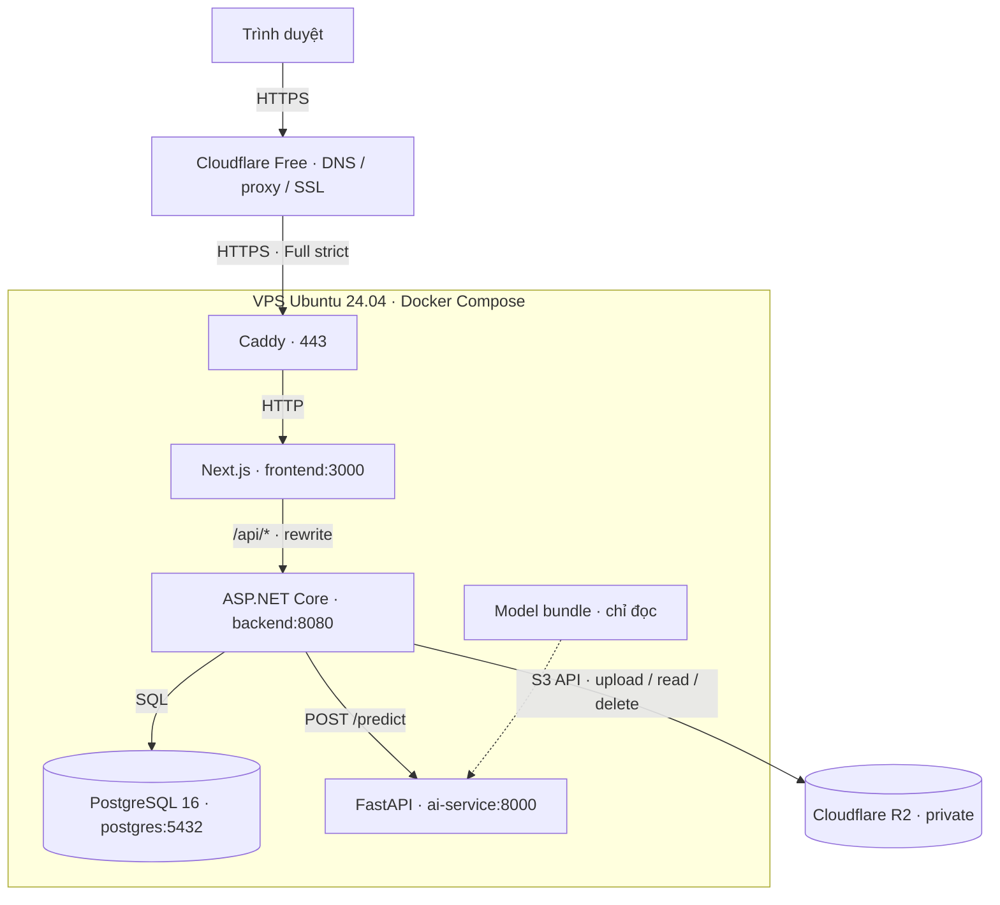

# Triển khai AgriVision AI trên VPS

> Phương án demo đã chọn, **chưa triển khai/nghiệm thu VPS thật**.
> Rút gọn ngày 2026-10-23 từ thiết kế AGRI-79 và cập nhật Cloudflare/R2 AGRI-140.
> Lịch sử và bằng chứng: [báo cáo AGRI-140](reports/AGRI-129/README.md).

## 1. Kiến trúc và luồng service

Sơ đồ kiến trúc production dự kiến; Compose local hiện chưa có Caddy/TLS.

- **Web/API cùng origin:** Caddy chuyển request tới Next.js; Next.js rewrite `/api/*`
  tới backend. Các port trong sơ đồ là port nội bộ container.
- **Dự đoán:** API gọi AI với checkpoint plant/disease, mapping và preprocessing
  đã kiểm chứng. Guest không lưu ảnh/history; user đăng nhập lưu ảnh R2 và metadata DB.
- **Xem ảnh:** trình duyệt gọi API bằng JWT; API kiểm owner/expiry rồi đọc R2,
  trả bytes với `Cache-Control: private, no-store`. Trình duyệt không gọi R2 trực tiếp.

## 2. Hạ tầng và cấu hình cần giữ

| Hạng mục | Phương án |
|---|---|
| VPS | DigitalOcean Singapore, Ubuntu 24.04 x86_64; dự trù 4 vCPU / 8 GiB RAM / 160 GiB SSD, inference CPU |
| Runtime | Caddy + Next.js + .NET 9 + FastAPI + PostgreSQL 16 trên một máy |
| HTTPS | Cloudflare Free proxy, Universal SSL; Full (strict) tới Caddy dùng Origin CA |
| Release | GHCR, pin image digest; deploy manual bằng GitHub Actions `workflow_dispatch` |
| Dữ liệu | Volume PostgreSQL bền vững; R2 private; model bundle mount read-only |
| Định danh | Project Compose `agrivision-demo`, thư mục `/opt/agrivision` |

Cấu hình production cần tạo riêng trong `docker-compose.production.yml`, dùng image
đã publish. Không dùng nguyên Compose local vì còn publish port và bật Swagger.

- Chỉ Caddy nhận 80/443 từ dải IP Cloudflare; SSH giới hạn nguồn quản trị/deploy
  đã xác minh. Không publish port frontend/backend/AI/DB; kiểm cả firewall và Docker.
- Backend: `ASPNETCORE_ENVIRONMENT=Production`, `Swagger__Enabled=false`, DB host
  `postgres`, `AiService__BaseUrl=http://ai-service:8000`. Chỉ tin forwarded headers
  từ proxy đã cấu hình; kiểm HTTPS scheme/IP thật qua toàn chuỗi proxy.
- Frontend **build** với `API_PROXY_TARGET=http://backend:8080`; đổi env runtime
  không thay rewrite đã build vào image.
- Secret ở env file ngoài Git/image/log, quyền `0600`. Mount cert/key read-only;
  theo dõi hạn và thay Origin CA riêng, không dựa vào Caddy tự gia hạn file cert.
- Domain `agrivision.<domain-của-nhóm>` là placeholder. Bật Proxied, chờ Universal
  SSL Active, Always Use HTTPS; cache static công khai, bypass API/ảnh/history.
- R2 tắt public access (`r2.dev`/custom domain), credential chỉ backend và giới hạn
  bucket. Không fallback local; ảnh legacy chuyển riêng sau backup. Xem [hướng dẫn R2](reports/AGRI-129/r2_storage.md).
- Model bundle có hai checkpoint plant/disease, mapping, preprocessing, version và
  SHA-256; giữ dataset v1.4/nhãn đã chốt, không cần dataset trên VPS.
- Giữ volume qua các release; **không dùng `down -v`**. Có restart policy,
  health/readiness, log rotation và theo dõi RAM/disk.

## 3. Điều kiện trước deploy

Mục tiêu demo: khoảng 5 người dùng web, 1 inference tại một thời điểm; chấp nhận
ngắt ngắn khi cập nhật. Một VPS không có HA/zero downtime.

- FastAPI dùng 1 Uvicorn worker CPU; cần giới hạn hàng chờ tối đa 1 request,
  quá tải trả 429. Đồng bộ giới hạn upload client/API/AI/proxy (AI hiện 15 MiB/ảnh,
  tính thêm multipart overhead) và timeout sau benchmark; API hiện mặc định 15 giây.
- Benchmark image CPU với checkpoint thật: cold start, RAM đỉnh toàn stack,
  ít nhất 30 warm inference và web chạy đồng thời. Mục tiêu warm p95 ≤ 10 giây,
  **chưa đo**; chỉ giảm VPS xuống 4 GiB nếu RAM đỉnh ≤ 3 GiB và không OOM/swap kéo dài.
- Xác minh bucket R2 thật, owner/expiry/lỗi storage, catalog đủ 59 lớp khớp model;
  nghiệm thu cùng ảnh qua CLI → HTTP → API → web. Health check/storage fake chưa đủ.
- Cần hoàn thiện Compose production/Caddy, forwarded headers, publish/deploy,
  import catalog và script/timer backup/cleanup; checkout chưa có bộ production được kiểm chứng.
- Chuẩn bị VPS/domain thật, registry, SSH host key/kênh deploy, secret và model/checksum.
  Giá/khả dụng và quota dịch vụ kiểm lại trước khi thuê hoặc bật billing.

## 4. Quy trình release

1. Chọn commit đã merge `main`, xác minh CI đạt **đúng SHA** và các kiểm tra ở mục 3.
2. Build/publish image frontend/backend/AI; ghi manifest gồm commit, image digest,
   model/checksum, mapping/preprocessing version và migration list. VPS pull đúng digest.
3. Bootstrap Docker/Compose, firewall, DNS/TLS, secret, volume và model bundle.
   Serialize deploy; bật maintenance, ngừng writer/cleanup khi thay đổi schema/dữ liệu.
4. Backup DB, manifest và ảnh cần phục hồi thành bộ nhất quán; xác nhận bản ngoài VPS.
5. Chờ DB healthy; chạy CLI `--migrate` bằng **image backend release đích** trong
   container tạm. Lỗi migration thì dừng; HTTP startup chỉ kiểm schema, không tự migrate.
6. Import catalog production bằng công cụ riêng; không dựa vào development seed
   hoặc sửa migration lịch sử. Khởi động API/AI/web và kiểm readiness/smoke nội bộ.
7. Mở lại truy cập, kiểm domain theo mục 6; ghi manifest, backup ID và kết quả thực tế.

CLI tham khảo: [migration](notes/database_migrations.md).
Kế hoạch tự động hóa: [CI/CD](plans/ci_cd_plan.md).

## 5. Backup, cleanup và rollback

- **Backup:** dự kiến 02:00 giờ Việt Nam mỗi ngày và trước deploy/migration;
  `pg_dump` custom format + manifest + metadata và bản export ảnh còn hiệu lực.
  Tạm ngừng writer/cleanup để nhất quán; không chép thư mục PostgreSQL đang chạy.
- Mã hóa, ghi checksum/timestamp; giữ 7 bộ hàng ngày và 2 bộ trước deploy gần nhất.
  Lưu khóa riêng, chuyển bản ngoài VPS hàng ngày; R2 private không thay thế backup.
  Restore thử vào DB/volume riêng. Mục tiêu RPO 24 giờ/RTO 2 giờ **chưa diễn tập**.
- **Cleanup:** dự kiến timer 03:00 giờ Việt Nam gọi `--expire-images` cho ảnh hết
  hạn 30 ngày, giữ history/metadata; lỗi xóa cần retry. Chưa có scheduler cấu hình.
  Backup có thể giữ ảnh hết hạn tới hết vòng retention; sau restore cleanup trước mở app.
- **Rollback:** giữ ít nhất hai release. Chỉ đổi về image/model cũ khi tương thích
  schema; không tự migration `Down` hoặc xóa volume. Nếu không tương thích, giữ
  maintenance, sửa tiến lên hoặc restore bộ DB/ảnh + image/model tương ứng.
  DB restore không phục hồi object đã xóa ở R2; ghi rõ nguy cơ mất dữ liệu sau backup.

## 6. Checklist nghiệm thu

- [ ] CI đúng SHA; model/catalog 59 lớp khớp; inference thật xuyên CLI–HTTP–API–web đạt.
- [ ] Benchmark RAM/latency đạt; upload/timeout/hàng chờ và lỗi AI/storage được kiểm.
- [ ] HTTPS/Full (strict) đúng, không redirect loop/525/526; origin trực tiếp bị chặn,
      thay cert được kiểm; forwarded headers đúng và không cache dữ liệu riêng tư.
- [ ] Guest không lưu; user A không đọc/xóa history hoặc ảnh user B; expiry/cleanup/retry đúng.
- [ ] Recreate/reboot giữ DB/ảnh; migration riêng đạt với DB trống và DB cũ.
- [ ] Backup ngoài VPS, restore và rollback đã diễn tập; có manifest và bằng chứng thực chạy.

Chưa chạy thì ghi **Chưa chạy**. Kết quả local không xác nhận GitHub Actions hoặc VPS.
Hướng dẫn hiện có: [Docker local](notes/docker_run_guide.md),
[yêu cầu sản phẩm](system_requirements.md), [báo cáo kỹ thuật](reports/AGRI-129/README.md).
